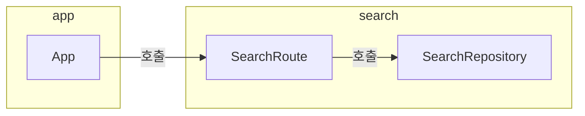
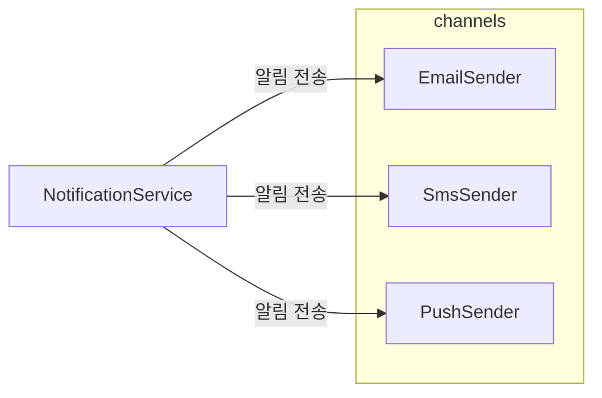
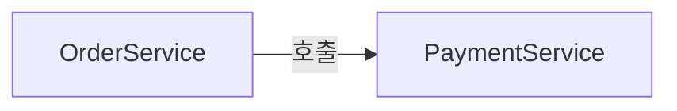

# Decision Examples

Read only when an unusual grouping, link, or consolidation case is unclear after
`SKILL.md` and `templates.md`. These show the basic form written before scripts;
`templates.md` is the single source for completed section shape.

## Contents

- Two groups and local links
- Multi-target consolidation and repository links
- No grouping or link evidence

## Two groups and local links

Input evidence:

- `app/App.kt` calls `feature/search/SearchRoute.kt`.
- `SearchRoute.kt` calls `data/SearchRepository.kt`.
- Purpose: onboarding.

Basic Dependency:

Decision points:

- `app` and `search` are evidence-backed groups.
- Group Collaboration contains `app → search` because one edge crosses them.
- Element Collaboration contains only the two directly connected pairs.
- Group links use evident common parent folders; element links use their files.

## Multi-target consolidation and repository links

Input evidence:

- `NotificationService` sends the same notification through `EmailSender`,
  `SmsSender`, and `PushSender` in one `channels` group.
- Each component has a stated repository file URL.
- Purpose: troubleshooting.

Basic Dependency:

Decision points:

- The three targets meet the same-source, same-group, same-nature, same-slot
  condition, so element Collaboration uses one collective target entry.
- A target with a different responsibility or relationship stays separate.
- Repository URLs are reused in Responsibility and Collaboration headings.

## No grouping or link evidence

Input evidence:

- `OrderService` calls `PaymentService`.
- No layer, namespace, file path, URL, or concrete responsibilities are stated.

Basic Dependency:

Decision points:

- Draw no `subgraph` and no `click` lines.
- Responsibility keeps both required levels and uses the specified unknown phrase
  where evidence is absent.
- Collaboration has one element pair and no group-pair section.
