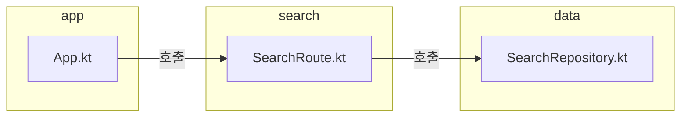
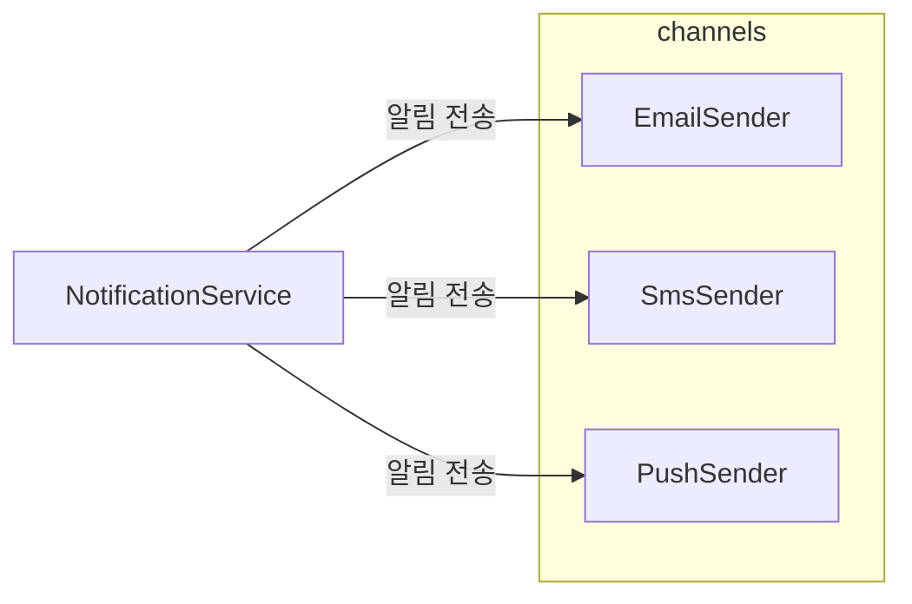
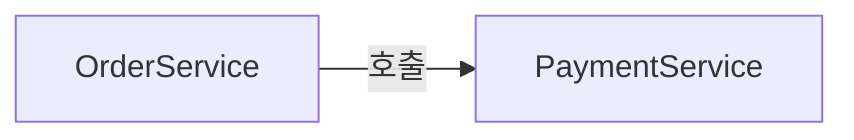
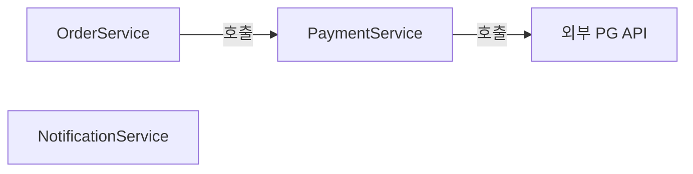
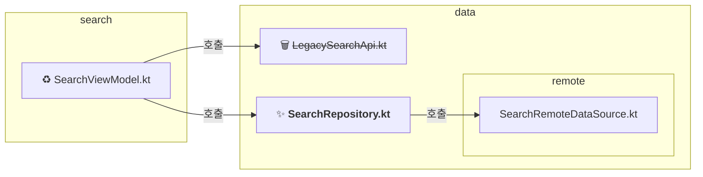

# Decision Examples

Read only when an unusual grouping, link, or consolidation case is unclear after
`SKILL.md` and `templates.md`. These show the basic form written before scripts;
`templates.md` is the single source for completed section shape.

## Contents

- Folder groups and local links
- Multi-target consolidation and repository links
- No grouping or link evidence
- Callerless sentence and external system
- Nested folders and a removed node

## Folder groups and local links

Input evidence:

- `app/App.kt` calls `feature/search/SearchRoute.kt`.
- `SearchRoute.kt` calls `data/SearchRepository.kt`.
- Purpose: onboarding.

Basic Dependency:

Decision points:

- Each file's parent folder is its group, even with one member; file nodes keep
  their extension.
- Group Collaboration contains `app → search` and `search → data`, one per
  crossing edge.
- Element Collaboration contains only the two directly connected pairs.
- Group links are the folders (`../app/`, `../feature/search/`, `../data/`);
  element links are the files.

## Multi-target consolidation and repository links

Input evidence:

- `NotificationService` sends the same notification through `EmailSender`,
  `SmsSender`, and `PushSender` in one `channels` group.
- Each component has a stated repository file URL.
- Purpose: troubleshooting.

Basic Dependency:

Decision points:

- The three targets meet the same-source, same-group, same-nature, same-slot
  condition, so element Collaboration uses one collective target entry.
- A target with a different responsibility or relationship stays separate.
- Repository URLs are reused in Responsibility and Collaboration headings.

## No grouping or link evidence

Input evidence:

- `OrderService` calls `PaymentService`.
- No layer, namespace, file path, URL, or concrete responsibilities are stated.

Basic Dependency:

Decision points:

- Draw no `subgraph` and no `click` lines.
- Responsibility keeps both required levels and uses the specified unknown phrase
  where evidence is absent.
- Collaboration has one element pair and no group-pair section.

## Callerless sentence and external system

Input evidence:

- `OrderService` calls `PaymentService`; `PaymentService` calls the external PG
  API.
- "After payment, `NotificationService` sends mail."

Basic Dependency:

Decision points:

- "After payment" is order in time, not a caller, so `NotificationService` has
  no edge and no Collaboration entry.
- The external API is an ordinary node; "외부" alone is not a group signal.

## Nested folders and a removed node

Input evidence (dynamic):

- Before: `feature/search/SearchViewModel.kt` called `data/LegacySearchApi.kt`.
- After: `SearchViewModel` calls new `data/SearchRepository.kt`, which calls
  `data/remote/SearchRemoteDataSource.kt`.
- `LegacySearchApi` was deleted; `SearchViewModel` was changed.

Basic Dependency:

Decision points:

- `data/remote` sits inside `data`, so its group nests. For group pairs each
  node counts only in its innermost group: `search → data` and
  `data → remote`.
- The removed node keeps its old edge with no extra edge mark, and keeps its
  stated path as a link.
- `SearchRemoteDataSource` is not named as added or changed, so it has no mark.
