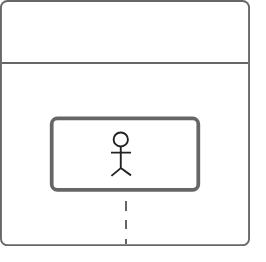

# Generating ZenUML Diagrams

Generate only evidence-supported ZenUML, save it as Markdown, and reply with the
file link.

## Workflow

1. Run `scripts/read_settings.py` and use its resolved values.
2. Classify the request as regeneration, new, colliding new slug, or ambiguous.
3. Read [references/syntax.md](references/syntax.md) before generating; target
   `mermaid-js/zenuml-core`, not standalone zenuml.com syntax.
4. Generate from the description, run the self-check, save, and log.

## Settings

Run scripts from the project root by full path. Find Python 3.9+ once: on Windows
try `python`, `py -3`, `python3`; elsewhere try `python3`, `python`, `py -3`.
Run `read_settings.py` fresh every time and never read or edit the settings files
yourself. A value in the current request overrides settings for that request.

If the script cannot run, use schema defaults and add:
`⚙️ 설정 안내: settings.jsonc 설정 스크립트를 실행하지 못해 모든 값을 기본값으로 사용`.
Append the script's notice lines unchanged to the chat response.

## Request classification

- A follow-up changing the diagram just shown is regeneration and keeps its slug.
- A self-contained process request is new.
- An unrelated new request whose slug exists uses `-2`, `-3`, etc.
- If conversation context cannot distinguish these, ask before touching a file.

## Generation rules

- Use only stated or clearly implied participants, messages, returns, branches,
  loops, and exception handling. Never invent scaffolding to complete the story.
- A call chain is nested according to the syntax reference, using the shallowest
  nesting that remains correct.
- Preserve real identifiers exactly. Write invented actor/behavior names and
  comments in the user's language; for scripts without letter case, use
  `snake_case` for invented multi-word names.
- Write a state change as a `// comment` on the line above the call that causes
  it, never as a message to oneself. A branch whose only effect is a state change
  gets `// → <result>` above its fragment and an empty block (a comment inside an
  empty block is not drawn). A message label is the function and its arguments
  (or a short action name); keep explanations in comments. A self-message is only
  for a real call to one's own function.
- Generate a faithfully large flow when requested. Do not truncate it, warn about
  length, or propose splitting it.
- If caller direction or a structural condition is ambiguous, ask one targeted
  question. Do not ask about cosmetic naming or ordering.

## Self-check

Before saving, fix and re-check:

1. No participant, message, return, branch, loop, or try/catch exceeds evidence.
2. Call chains and nesting match the syntax reference and are no deeper than
   necessary.
3. The output file contains only the required `zenuml` fence before
   `apply_style.py` runs; no state change is drawn as a self-message.
4. The chat response contains only the file link and permitted clarification,
   direct-answer, out-of-scope, or settings-notice lines.

## Output and logging

Write `.zenuml/<slug>.md` containing only:

````markdown

````

Initial/colliding requests never overwrite an unrelated file. Regeneration
overwrites the target completely. Ensure `.zenuml/` is ignored, adding the entry
only when absent. With no filesystem, return only the DSL code block and skip
logging.

After saving:

1. Run `apply_style.py <output>`; add `--style=<readable|zenuml-default>` only
   when this request states the look. It adds or removes the style block at the
   end of the file; never write that block yourself.
2. Write only the relevant-turn request summary to a temporary UTF-8 text file.
3. Resolve the log as `<log.directory>/<slug>.md`, then run
   `append_feedback.py <output> <resolved log path> <request file>
   --mode=<new|append>`. Use `new` for initial/colliding requests and `append`
   for regeneration. The helper consumes the request file and copies the saved
   output verbatim; do not reproduce it yourself on success.
4. If the helper fails, read
   [references/feedback-log.md](references/feedback-log.md) and preserve the
   existing append-only contract manually.
5. Reply with the relative file link.

The request summary gathers every turn since the previous round that shaped the
diagram, including clarification, and omits unrelated talk. Changing
`log.directory` never moves old logs; regeneration starts Round 1 when no log
exists at the current location.

## Out of scope

- Non-sequence diagrams.
- Converting an existing diagram rather than a natural-language process.
- Rendering an image; the saved Markdown is the primary DSL output.

For a codebase request, inspect the code first and distill an evidence-citing
process description, then use that description. State other boundaries briefly
without inventing a workaround.
