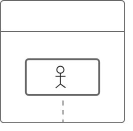

# Feedback log fallback

Read this only when `append_feedback.py` fails or another task cites a log.

Append the saved diagram exactly:

````markdown
## Round N — <ISO date>
**Request**: <all relevant turns since the previous round, lightly edited>

**Response**:

````

Initial generation and a colliding new slug start a fresh Round 1. Regeneration
keeps old rounds and appends the next number; at a newly configured log location
it starts Round 1. Never summarize, analyze, or prune the log.

Logs remain ignored unless another task actually cites one. Then stage only that
file with `git add -f <log path>`. Never move old logs or change `.gitignore` for
a custom location.
