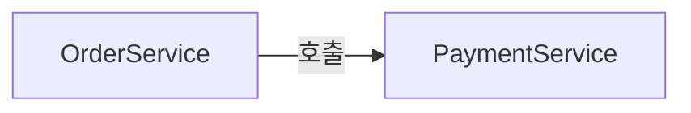

# Generating Architecture Views

## Workflow overview

0. Read the settings (see "Settings" below).
1. Determine the purpose (from what's stated/implied; ask only if genuinely unclear), and classify the request as structure (static) or structure change (dynamic).
2. Generate the Dependency section (components, groups, relationship-labeled and color-coded diagram, hyperlinks).
3. Generate the Responsibility section (per-group and per-element, abstract + concrete) — unless its display setting is `hidden`.
4. Generate the Collaboration section (dependency-gated group and element entries, with multi-target consolidation) — unless its display setting is `hidden`.
5. Self-check (AP-1–AP-15) and fix before presenting.
6. Save the architecture view file, run the diagram script on it (see "Diagram script" under "Output file"), write the feedback log from the finished file, then — if hover is on — run the hover script (see "Hover panels"), and present the file link. That's the end — this skill produces only the architecture view.

## Settings

Before anything else in each run, find a Python 3.9+ interpreter as `python3`, then `python`, then `py -3`, and run it by its full path, without changing the working directory (paths stay relative to the project root):

```text
<python> <this skill's directory>/scripts/read_settings.py
```

It prints one line of JSON: `values` (every option resolved from `settings.schema.json` and the user's `settings.jsonc`; missing file or keys fall back to defaults, invalid values fall back per key, unknown keys are ignored) and `notices` (ready-made `⚙️ 설정 안내: …` lines). Use `values` as this run's settings — run it fresh every run, never reuse an earlier result, and don't read either settings file yourself. Add each `notices` line, as is, at the end of the chat response — never into the output file.

- **No Python 3.9+, or the script fails**: read only the `default` of every option in `settings.schema.json`, use those, finish the work, and add `⚙️ 설정 안내: settings.jsonc — 설정 스크립트를 실행하지 못해 모든 값을 기본값으로 사용` at the end of the response.
- **The request itself names a value** for something an option controls: use what the request says, for this request only.

Never edit either settings file. What each option actually does lives in the step it affects (Steps 2–4, "Output file").

## Step 1 — Confirm the purpose

Before generating anything, judge whether the purpose is already clear — either stated outright or clearly implied by context (e.g., "새로 합류한 팀원에게 보여주려고" implies onboarding; "OrderService 쪽에서 이상한 게 있어서 봐야 해" implies troubleshooting). If so, use that purpose and don't ask — only stop for ambiguity that actually matters. Only when the purpose is genuinely unclear — you can't reasonably tell which of the three it is — ask before doing anything else:

```text
이 구조 뷰를 어떤 목적으로 보시나요?
1. 온보딩 — 전체 구조를 이해하고 싶다
2. 특정 문제 진단 — 특정 컴포넌트/관계에 집중하고 싶다
3. 기타 — 직접 설명
```

- A clear answer to 1/2/3 sets the purpose. For "기타" (3), ask one more question — "어떤 정보가 필요하신지 한 문장으로 알려주세요" — and wait for that answer before continuing.
- An ambiguous answer or no answer at all (the user asks something unrelated instead) is **not** treated as agreement to guess — default to **온보딩** and say so explicitly in your response (e.g., "목적을 명확히 하지 않으셔서 온보딩 기준으로 진행합니다").
- In the current scope, the confirmed purpose does not change which sections get produced — Dependency, Responsibility, and Collaboration are always all three generated (see Steps 2–4) regardless of purpose. That's exactly why this question isn't worth forcing on every request: don't ask it just to have asked it — only when you genuinely can't tell which purpose applies.
- If the description doesn't identify any components at all, don't ask about purpose — ask what process/system to diagram instead.

### Static or dynamic

Also classify every request (regenerations included, judged fresh each round) as exactly one of:

- **Structure change (dynamic)** — the request asks what changed: a commit, PR, diff, before/after of a refactor, "무엇이 추가/변경/삭제됐나". Step 2 then marks the added/changed/removed nodes (see "Change marking").
- **Structure (static)** — everything else. No node gets a change mark.

Decide from the request and context without asking; only when you genuinely can't tell, ask briefly: "현재 구조를 보여드릴까요, 변화(추가·변경·삭제)를 표시할까요?"

## Step 2 — Generate Dependency

Use only components and dependencies the description explicitly states or clearly implies — never add one to make the picture feel complete. Each arrow represents a relationship the description directly states or implies between those exact two components — if the description only establishes a chain (A calls B, B calls C), draw A→B and B→C, never a collapsed A→C shortcut implying A relates to C directly when nothing said that.

Group components with a Mermaid `subgraph` **only** when the description gives an actual signal: a shared name prefix/namespace, or an explicit layer/domain word ("주문 도메인", "인증 계층", etc.). If there is no such signal, do not create any `subgraph` — treat every component as part of one unlabeled set instead (this still counts as "one group" for Steps 3–4, it's just not drawn as a box).

**Diagram shape**: write only the basic diagram — the diagram script fills in everything else (config block, edge IDs, colors, section comments, CRUD block). Inside the code fence: `flowchart LR`, then the node/group declarations, a blank line, the edges, and — only if any — the `class <Id> crud*` lines and the `click` lines. Groups are `subgraph Id["라벨"]` with `direction TB` inside and `end`. A node whose display name can't serve as its ID (parentheses, spaces, etc.) is declared `Id@{ label: "표시 이름" }`; declare every node, in the order you introduce them. Write every edge as `Source -->|관계 성격| Target` — no edge IDs, no `classDef`/`class` color lines, no `linkStyle`, no `%%` comments, no config/frontmatter.

**Renderer selection**: only when the user explicitly names a Mermaid renderer in the request (e.g. "elk"), pass it to the diagram script as `--layout=<the exact value they typed>` — open vocabulary, never validated or remapped. Otherwise pass nothing; the script follows the `dependency.renderer` setting. A renderer named in an earlier round never carries over on its own.

**Relationship labels**: label every arrow with the nature of the relationship as the description states or clearly implies it (e.g., 호출, 타입 참조, 선언 참조, 화면·타입 참조— this vocabulary is open-ended, not a fixed enum). If the description doesn't specify a relationship's nature, label it with the generic default "호출" rather than guessing a more specific nature that wasn't stated.

**Node and edge coloring**: done entirely by the diagram script — every node gets its own border-color class and every edge its source node's color, in node declaration order. You write no color lines.

**Change marking** (dynamic requests only): mark only the nodes the description states or clearly implies were added, changed, or removed — never guess a change for a node it doesn't mention. Prefix the label and add one `class` line after the edges:

| Change | Label | Class line |
|---|---|---|
| Added (C) | `Id["✨&nbsp;<b>Name</b>"]` | `class Id crudCreate` |
| Changed (U) | `Id["♻️&nbsp;Name"]` | `class Id crudUpdate` |
| Removed (D) | `Id["🗑️&nbsp;<s>Name</s>"]` | `class Id crudDelete` |

The diagram script adds the `crud*` class definitions; the node keeps its own color. Draw a removed node with the relations the description says it had. Don't add a legend. In a static request, write no `class … crud*` line and no prefix.

**Hyperlinks**: attach a `click NodeName "target" "label"` directive to every node whose real location the description establishes (see "Hyperlink resolution" below for how `target` is determined). Skip `click` entirely for a node with no resolvable target — don't invent one. The `label` is always the target's file name (e.g. `"Foo.kt"`); you never write tooltip content yourself. When hover is on, the hover script later replaces these labels with each node's panel text, adds a non-navigating `click Id hoverOnly "…"` line for nodes without a target (a tooltip only — no destination is invented), and appends `,cursor:auto` to those nodes' color `classDef` lines; you never write any of that. Never add a note about whether a renderer follows `click` links or where else to find them — the `click` directives and the Markdown links in Responsibility/Collaboration speak for themselves.

**Caption**: put exactly one short plain-text line between the `### Dependency` heading and the Mermaid code fence, saying what this diagram depicts. Build it only from the key keywords of the user's request — the system/process it names and the aspect they asked to focus on (e.g. a request "Jetpack Navigation 3에서 백스택과 화면 전환 구조를 보여줘" → `Jetpack Navigation 3의 백스택과 화면 전환 의존 구조`). Write it in the user's language, as a plain line (not a blockquote, heading, or bold text), with nothing the request didn't say and nothing about rendering, layout, or how the view was produced. On regeneration, rewrite it to reflect every request up to this round.

### Hyperlink resolution

Applies identically here (as `click`) and in Responsibility/Collaboration (as a Markdown link on the bold name) — resolve once per group/element and reuse the same target in both places:

1. **Local root project**: if the description gives (or clearly implies) a real file/folder path inside the project this skill is running against, link to that path, relative to `.zenuml/` (e.g. a component whose file lives at `app/src/.../Foo.kt` becomes `../app/src/.../Foo.kt`). A group links to the common parent folder shared by its members' paths (e.g. `../app/`) when one is evident.
2. **Web-hosted repository**: if the description gives a repository URL (instead of, or alongside, local paths), link to that file's URL. A group links to the folder's URL.
3. **Neither**: if the description gives no real location for a group or element, leave its name as plain text — don't fabricate a path or URL.

This skill never derives these targets itself by reading or searching the codebase (FR-022 still applies) — it only carries forward locations the description already states as evidence. If the user wants the description built from a real codebase first, point them to "Out-of-scope requests" below.

## Step 3 — Generate Responsibility

If `responsibility.display` is `hidden`, skip this whole step — don't work out responsibilities at all, write no `### Responsibility` section, and skip the self-check items that only concern Responsibility (AP-6, AP-6b). Otherwise generate it as below, then wrap it per "Section display" (Output file).

No pairwise comparison here — every group and every element gets its own two-part entry, except parallel sibling elements that qualify for consolidation below (see "Parallel-sibling consolidation"):

- <strong>책임 (추상)</strong>: one sentence, the high-level responsibility, in your own words but grounded in what the description says.
- <strong>역할 (구체)</strong>: a more concrete sentence citing the actual names/behaviors the description mentions (specific method calls, fields, sub-parts) — this is what makes the entry more than a restatement of the abstract line. Wrap every cited code-level identifier (class/function/property/enum-case name) in backtick code spans (`` `NiaAppState` ``, `` `navigateToTopic()` ``) — never leave a real identifier as bare prose.

Order: `#### 그룹의 책임` first (skip this subsection entirely if there are no groups), then `#### 요소의 책임` for every element. Each bullet's heading is the group/element's bold name, hyperlinked per "Hyperlink resolution" above.

**Bold markup**: use `<strong>...</strong>` HTML tags for every bold element in Responsibility and Collaboration — names and field labels (책임 (추상), 역할 (구체), 책임의 경계, 분리 이유 & 합리성 평가, 내가 할 수 있는 질문) alike — never markdown `**...**`. This matches this repository's `.zenuml/` convention and renders reliably even when the bold text wraps a Markdown link (`<strong>[이름](경로)</strong>`).

If the description doesn't give enough to write one of the two levels, write `설명에 명시되지 않음` for that level specifically — don't invent a plausible-sounding responsibility or role, and don't skip the level, since a level being empty is itself relevant information (compare Step 2's "no components beyond the description" rule).

### Parallel-sibling consolidation

When **3 or more** elements share the same group and play a parallel structural role — each fills the same kind of slot relative to a common relationship (e.g., each is its own route-registration contract called the same way by the same host, each is its own channel-sender implementation) — and none of them carries a responsibility genuinely different in kind from the others (differing only in name or implementation specifics, like which identifier it exposes, doesn't count), combine them into one entry instead of one per element. Head the entry with every member's name, each individually hyperlinked, joined with commas (e.g. `<strong>[A](path)</strong>, <strong>[B](path)</strong>, <strong>[C](path)</strong>`). 책임 (추상) becomes one shared sentence describing that parallel role; 역할 (구체) must still cite each member's own specific identifiers/behavior — consolidating the entry never means dropping any member's individual evidence.

If any member actually carries a responsibility or relationship the others don't (not just a different name — a real difference in kind), exclude that member from the combined entry and give it its own individual entry instead. Fewer than 3 qualifying siblings, or any real difference in kind of role, means no consolidation — list each individually as usual.

This reuses the exact same threshold and judgment as Step 4's "Multi-target consolidation" for Collaboration — don't invent a second mechanism.

## Step 4 — Generate Collaboration

If `collaboration.display` is `hidden`, skip this whole step — no `### Collaboration` section, and skip the self-check items that only concern Collaboration (AP-7–AP-10). Otherwise generate it as below, then wrap it per "Section display" (Output file).

This section holds every entry for a pair (or, per "Multi-target consolidation" below, a source and a consolidated set of targets) with a **real dependency between them** — no dependency, no entry, at either level below.

**Group level** (only when Step 2 produced 2 or more groups): one entry per unordered pair of groups with **at least one dependency edge crossing between their members**. A group pair with no such edge gets no entry. Ground each side's identity in the name/label the description actually gave that group (plus anything else the description states about it beyond the bare label) — never a guessed role or purpose. This matters most for structurally-named groups ("app 모듈", "feature 모듈") where the label alone carries no semantic content.

**Element level**: one entry per unordered pair of elements **directly connected by a dependency**, regardless of whether the two elements are in the same group or different groups — element-level entries are not restricted to within-group pairs; a cross-group edge gets both an element-level entry here and contributes to that group pair's group-level entry above. Generate entries in first-appearance order (source nodes in the order they first appear in Dependency, then each source's targets in the order their edges appear) so you don't accidentally produce the same pair twice.

**Format**: every entry — group-level and element-level — puts every name involved in `<strong>...</strong>` and states the real dependency direction as the entry's opening line, never a neutral "vs": <strong>A</strong>는 <strong>B</strong>에 의존한다 for a one-way dependency, or <strong>A</strong>와 <strong>B</strong>는 서로 의존한다 if the dependency runs both ways. Every name in that opening line is hyperlinked per "Hyperlink resolution" above whenever a target resolves for it — the same requirement Step 3 applies to Responsibility headings, reusing the identical target already resolved for that group/element (plain `<strong>` text with no link when no target resolves). This applies equally at the element level, not just the group level — a long list of element-level entries is not an exemption. Each entry then has three sub-parts, all required, and each sub-part is its own `<strong>` heading bullet followed by a **nested** bullet list of 2–4 short, concrete points — never a single inline "레이블: 문장1. 문장2." paragraph:

- <strong>책임의 경계</strong>
  - what one side is responsible for
  - what the other side is responsible for
  - where responsibility crosses from one to the other
- <strong>분리 이유 & 합리성 평가</strong>
  - why this wasn't merged into one thing
  - whether that separation still holds up
- <strong>내가 할 수 있는 질문</strong>
  - a short list of questions worth re-asking when reviewing this boundary later (2–3 items)

Wrap every cited code-level identifier inside these nested bullets in backticks, the same rule as Step 3's 역할 (구체) — e.g. "`app`은 어떤 목적지가 존재하는지 결정한다" rather than a bare "app은 ...". This plain-backtick, no-bold-no-link treatment applies **only inside the nested sub-bullets** (책임의 경계/분리 이유 & 합리성 평가/내가 할 수 있는 질문) when a group or element that already has its own `<strong>[이름](경로)</strong>` heading elsewhere in this file is mentioned again there — it does **not** apply to the entry's opening line (<strong>A</strong>는 <strong>B</strong>에 의존한다), which always keeps its own `<strong>` name and hyperlink per the Format rule above, at both the group and element level.

Write every entry as a fully self-contained unit — restate both sides' context in full each time, never a backreference like "위와 동일". Quality shouldn't taper off across a long list.

### Multi-target consolidation

When one source depends on **3 or more** targets that all share the same group **and** the same relationship nature **and** play a parallel structural role relative to that source — each fills the same kind of slot in the pattern (e.g., each is an individual channel sender, each is a route-registration contract for its own feature) — don't create one entry per target — collapse them into a single entry whose target side is a descriptive collective phrase for the set (e.g. "feature 내비게이션 요소들"), not each name spelled out. This is this format's scale-control mechanism, replacing the old exhaustive-pairwise approach — see "Scale control" below.

Targets that each have their own edges elsewhere in the diagram, or their own distinct wording in Responsibility (e.g. different function names), still qualify for this — a difference that's just *which name/implementation fills the same role* is not a reason to exclude a target. Only exclude a target when it actually carries a responsibility or relationship the others don't (a real difference in kind, not just a different name) — that target keeps its own individual entry instead of being folded into the collective phrase.

If the targets number 2 or fewer, or belong to different groups, or differ in relationship nature, list each one by name instead (joined with "와"/"과" for two) — don't consolidate.

## Self-check before presenting

Copy this into your working notes before showing a structure view:

```text
Architecture view anti-pattern check:
- [ ] AP-1: No components beyond what the description states or clearly implies
- [ ] AP-2: No dependencies beyond what the description states or clearly implies, and no chain (A calls B, B calls C) collapsed into a shortcut edge (A→C) that skips the intermediate hop
- [ ] AP-3: No subgraph group without an explicit naming/layer/domain signal in the description
- [ ] AP-4: Every arrow has a relationship-nature label grounded in the description, or the "호출" default when the description doesn't specify one — never a guessed specific nature
- [ ] AP-5: The diagram you wrote is the basic form — `flowchart LR`, declarations, `Source -->|관계| Target` edges, then only `class <Id> crud*` and `click` lines; no config block, edge IDs, color `classDef`/`class` lines, `linkStyle`, or `%%` comments
- [ ] AP-5b: `--layout=<value>` is passed to the diagram script exactly when this request named a renderer (that exact value), never carried over from an earlier round
- [ ] AP-5c: Static request → no `class … crud*` line and no ✨/♻️/🗑️ prefix; dynamic request → exactly the nodes the description names as added/changed/removed carry the matching prefix and class
- [ ] AP-6: Every group and every element has both 책임(추상) and 역할(구체) — "설명에 명시되지 않음" where the description doesn't support one, never a guess; every code-level identifier cited in 역할(구체) is wrapped in backticks
- [ ] AP-6b: Responsibility parallel-sibling consolidation was applied only where the condition holds (3+ elements, same group, parallel structural role, no member with a genuinely different kind of role) — the combined heading lists and hyperlinks every member, 역할(구체) still cites each member's own evidence, and a member with a real difference in kind was excluded and given its own entry instead
- [ ] AP-7: Group-level Collaboration entries exist only for group pairs with at least one cross-group dependency edge (zero if 1 or fewer groups)
- [ ] AP-8: Element-level Collaboration entries exist only for element pairs with a direct dependency edge (same-group or cross-group both count) — no entry for a non-dependent pair
- [ ] AP-9: Collaboration multi-target consolidation was applied only where the condition holds (3+ targets, same group, same relationship nature, parallel structural role — individual edges or distinct Responsibility wording don't block it by themselves) — not applied where it doesn't (2 or fewer, mixed groups, mixed nature, or a target with a genuinely different kind of role, which stays its own entry)
- [ ] AP-10: Every Collaboration entry uses `<strong>` names, the real dependency direction (<strong>A</strong>는 <strong>B</strong>에 의존한다, or 서로 의존한다 if bidirectional), all three of 책임의 경계/분리 이유 & 합리성 평가/내가 할 수 있는 질문 each as a `<strong>` heading with its own nested bullet list (not an inline paragraph), and backticks around every cited code-level identifier
- [ ] AP-11: No section comparing concepts that don't appear as identified groups/elements in the description
- [ ] AP-12: Every entry (Responsibility and Collaboration alike) restates its content in full and independently (no "위와 동일"-style backreferences), and entries don't get thinner/more generic later in a long list than earlier
- [ ] AP-13: Every hyperlink (both `click` and Markdown links) matches the resolution rule — local relative path, repo URL, or no link at all — and none is fabricated beyond what the description gives as evidence; AND every group/element with a resolved target is linked consistently everywhere its bold name appears as a heading or entry-opening name — Responsibility heading, Collaboration group-level opening line, and Collaboration element-level opening line all carry the same link (spot-check the element-level Collaboration entries specifically, since they're the most numerous and the easiest place for a link to silently go missing)
- [ ] AP-13b: Exactly one plain-text caption sits between `### Dependency` and the Mermaid fence, built only from the request's key keywords — no invented content, no rendering/layout/process talk
- [ ] AP-13d: Each of Responsibility/Collaboration matches its display setting (or the request's override): `hidden` — heading and content entirely absent; `plain` — no box; `collapsed`/`expanded` — heading outside, content inside one `<details>` box (with `open` only for `expanded`) whose summary is the fixed text `Details` (never the section name), content identical to `plain`
- [ ] AP-13c: The file holds nothing but the three headings, the caption, and the sections' actual content — no click-navigation note, length notice, renderer warning, layout explanation, or other meta commentary; every `click` label you wrote is the target's file name, and you wrote no panel text, `hoverOnly` line, `cursor:auto`, or `<style>` block (only the hover script adds those) — and the chat response holds only the file link (plus a needed clarifying question, the onboarding-default notice, settings notices, or hover notices)
- [ ] AP-14: The request has been classified (initial generation vs. regeneration vs. colliding slug) and the log write matches it — fresh Round 1, or a new round appended without touching earlier ones — and no output file or log gets written at all if Steps 2–4 never completed
- [ ] AP-15: No sequence/runtime-flow diagram drawn, and no offer or question about building one — the response ends with the architecture view
```

Workflow: generate a draft → check it against AP-1 through AP-15 (including AP-13b/13c) → if anything fails, revise → re-check → only then present the result. Don't narrate the checklist to the user; just perform it before responding.

## Output file

Don't paste the Dependency, Responsibility, or Collaboration content into the chat response. Save it to a file and link to it instead: file links don't trigger unwanted auto-preview behavior the way Claude Artifacts do, and this repository already has a working Mermaid-preview path through VS Code.

**Where**: `.zenuml/<slug>.architecture.md`, where `<slug>` is a short kebab-case name derived from what the view is about. Write only `*.architecture.md` files (and their logs) — never touch any other file in `.zenuml/`.

**Request classification**: before writing, classify the request — (1) *Regeneration* (a follow-up refining the architecture view just shown in this conversation) overwrites the existing `.zenuml/<slug>.architecture.md` completely; (2) *Initial generation* (a self-contained description with no existing file for this slug) creates a new file; (3) *new request with a colliding slug* (an unrelated description that happens to hash to an existing `.zenuml/<slug>.architecture.md`) appends `-2`, `-3`, … rather than overwriting; (4) if genuinely unclear which of the three this is, ask rather than guessing.

**File contents**: a `### Dependency` heading followed by its one-line caption (Step 2, "Caption") and then its Mermaid code fence, then `### Responsibility`, then `### Collaboration`, in that order — no other ordering. A section whose display setting is `hidden` is simply absent; the others keep this order. Use `###` for all three (never `##` or shallower, matching this repository's `.zenuml/` heading convention). Within Collaboration, `#### 그룹 간 비교` (if 2+ groups) comes before `#### 요소 간 비교`.

**Section display**: Dependency is never boxed. For Responsibility and Collaboration, `plain` writes the section as is. `collapsed` and `expanded` keep the `###` heading outside and put everything under it inside one box whose summary is always the fixed text `Details` — the section name appears only in the heading, never repeated in the summary — with a blank line after `<summary>`, blank line before `</details>`, so the Markdown inside renders (see `references/templates.md`, "Collapsible section"):

```markdown
### Responsibility

<details>
<summary>Details</summary>

…the section's content, unchanged…

</details>
```

`expanded` is the same with `<details open>`. This box is structure, not commentary — it's the one thing besides content allowed in the file.

**Nothing but content**: the file holds only those three headings, the caption, the boxes from "Section display", and the sections' actual content (the diagram, Responsibility entries, Collaboration entries) — plus what the diagram script adds to the diagram, and, only as written by the hover script, the panel text in `click` labels, the `click Id hoverOnly "…"` lines, `,cursor:auto` on color `classDef` lines, and the panel-shaping `<style>` block at the very end of the file (display rules, not commentary). Never add meta commentary in any form — blockquote, paragraph, or comment — such as renderer-compatibility warnings, layout/arrangement explanations, notes on how or why the view was built, length notices, or link-behavior notes. The same applies to the chat response, which holds only the file link; the only other things allowed there are a clarifying question the workflow actually needs (Step 1, or when no components can be identified), the onboarding-default notice from Step 1, the settings notices from "Settings", and the hover notices from "Hover panels".

After writing, the entire chat response for this part is a relative link:

📄 [<slug> 구조 뷰](.zenuml/client-server.architecture.md)

If there is no filesystem access in the current environment, skip the file and put all three sections directly in the chat response as fenced/plain blocks instead. Skip the feedback log below too in that case — there's no file to log against.

### Diagram script

**When**: right after writing `.zenuml/<slug>.architecture.md`, before the feedback log. With the Python found in "Settings", run it by its full path, without changing the working directory (paths stay relative to the project root):

```text
<python> <this skill's directory>/scripts/build_diagram.py <path to .zenuml/<slug>.architecture.md> [--layout=<renderer the request named>]
```

It completes the Dependency diagram in place (config block, edge IDs, color classes, section comments, CRUD block) and prints one line. Non-zero exit or no Python 3.9+: leave the file as it is and add `⚙️ 다이어그램 서식 건너뜀: <the script's message, or Python 3.9 이상을 찾지 못함>` at the end of the response.

### Hover panels

In VS Code's Markdown preview, hovering a Dependency node shows a panel with that node's Responsibility and the collaborations it depends on. The panel text is a copy of the file's own body, written by a bundled script — never by you — so it costs no extra output.

**When**: after the feedback log, if hover is on for this request. Hover is on when `hover.enabled` is `true` and at least one of `hover.responsibility`/`hover.collaboration` is non-empty — after applying any value the request itself states ("hover 빼고", "질문도 넣어줘", "노드 아래에 띄워줘"). If hover is off, don't run the script; the file is already in its no-hover form.

**How**: find a Python 3.9+ interpreter as `python3`, then `python`, then `py -3`, and run it by its full path, without changing the working directory (paths stay relative to the project root):

```text
<python> <this skill's directory>/scripts/apply_hover.py <path to .zenuml/<slug>.architecture.md> [--enabled=…] [--responsibility=…] [--collaboration=…] [--position=…]
```

Add an option only for a hover value the request itself states (e.g. `--collaboration=targets,boundary,rationale,questions`, `--position=node`, `--responsibility=` for none); the script reads `settings.jsonc` for everything else.

- The script prints one result line and possibly `⚙️ 설정 안내: …` lines. Add those notice lines to the end-of-response settings notices, without repeating a line you already have.
- No Python 3.9+ found: skip the script and add `⚙️ hover 건너뜀: Python 3.9 이상을 찾지 못함` at the end of the response. The view is still saved and still counts as done.
- Non-zero exit: leave the file as it is and add one line at the end of the response saying hover could not be applied (with the script's message).
- The feedback log keeps the content you wrote, before the script ran — never copy the panel text into it.

**Re-syncing an existing file**: when the user only asks to refresh the hover panels of an existing architecture view (e.g. after editing its body by hand, or for a file made before hover existed), don't regenerate the view and don't write a log round — just run the script on that file (with options only for values the request states) and present the file link.

### Architecture view feedback log

Alongside `.zenuml/<slug>.architecture.md`, every successfully generated or regenerated architecture view gets a feedback log at `<log.directory>/<slug>.architecture.md` — same slug, in the directory the `log.directory` setting names, resolved from the project root (default `./.zenuml/log`, i.e. `.zenuml/log/<slug>.architecture.md`). Create the directory if it doesn't exist. Changing the setting never moves or deletes logs already written elsewhere — a regeneration just continues in the log at the currently configured location (starting a fresh Round 1 there if none exists yet). The default location is already covered by the `.zenuml/` `.gitignore` entry; if the setting points somewhere `.gitignore` doesn't cover, leave `.gitignore` alone — that's the user's call.

**What goes in the `**Request**:` field**: not just the single message that immediately triggered this round. Gather every turn since the previous round (or, for Round 1, since the conversation about this architecture view started) that actually contributed to what got built — including the purpose-confirmation exchange from Step 1, if that's how this round's scope was pinned down. Drop anything unrelated (small talk, tangents), and lightly edit the rest into one coherent entry rather than pasting a raw transcript.

**On initial generation** (or a new request with a colliding slug), create the log fresh:

````markdown
## Round 1 — <ISO date>
**Request**: <the user's request, verbatim or lightly summarized>

**Response**:
<the content of `.zenuml/<slug>.architecture.md` after the diagram script, before the hover script>
````

**On regeneration**, append a new round to the existing `<log.directory>/<slug>.architecture.md` — never rewrite or delete earlier rounds, no matter how many rounds accumulate:

````markdown
## Round N — <ISO date>
**Request**: <this round's request>

**Response**:
<the content of `.zenuml/<slug>.architecture.md` after the diagram script, before the hover script>
````

Don't summarize, analyze, or prune this log's content, ever — it exists purely so a human can read it later and decide what's worth acting on. If Steps 2–4 never completed (the request ended in a clarifying question instead of a finished architecture view), don't create either the output file or the log file — there's nothing to save yet.

**Citing a feedback log elsewhere**: the default log location `.zenuml/log/` is gitignored, same as the rest of `.zenuml/`. If some other piece of work actually reads and cites a specific `<log.directory>/<slug>.architecture.md` as a source, stage that one file right then with `git add -f <log.directory>/<slug>.architecture.md` — nothing else gets staged automatically, and uncited logs stay untracked.

## Out-of-scope requests

- **Class diagrams, deployment diagrams, or any non-Dependency/Responsibility/Collaboration structural view**: say this skill only produces those three things; it doesn't attempt a workaround.
- **Sequence diagrams, call order, or runtime/behavior flow**: say this skill only produces structural views. Don't draw one, and don't suggest or run any other tool for it.
- **Analyzing an actual codebase to produce the view**: this skill's self-check only verifies that a view doesn't exceed a *given* description — it has no way to verify that a description faithfully covers an entire codebase. So this skill still takes only a natural-language description as input, not raw code or a repository. If real code is available, read it yourself first (directly, or via Explore/Grep/gh), distill what you find into a description that cites concrete evidence (file paths, exact identifiers, repository URLs, commit/PR references — this evidence is also what "Hyperlink resolution" above needs), then pass that description in as normal.
- **Comparing concepts that aren't groups/elements identified in the description** (e.g., "Controller vs Application 패턴이 뭐가 다른가요?" with no such components in the input): say Collaboration only compares groups/elements actually identified from the description, not general concepts or patterns.

### Example: minimal request

Input: "OrderService는 주문을 생성하고, PaymentService는 결제를 담당하며, OrderService가 PaymentService를 호출한다. 이 시스템의 구조를 보여줘." Purpose confirmed as 온보딩. No file paths or URLs given, so no hyperlinks are attached.

What you write to `.zenuml/<slug>.architecture.md` (not pasted into the chat response; the diagram script then completes the fence) — shown with both display settings at `plain`; with `collapsed`/`expanded` each of Responsibility and Collaboration is wrapped as in "Section display", and with `hidden` it's absent:

````markdown
### Dependency

OrderService와 PaymentService의 주문·결제 의존 구조



### Responsibility

#### 요소의 책임

- <strong>OrderService</strong>
  - <strong>책임 (추상)</strong>: 주문 생성을 담당한다.
  - <strong>역할 (구체)</strong>: 주문을 생성하는 처리를 수행한다.
- <strong>PaymentService</strong>
  - <strong>책임 (추상)</strong>: 결제를 담당한다.
  - <strong>역할 (구체)</strong>: 결제 처리를 수행한다.

### Collaboration

#### 요소 간 비교

- <strong>OrderService</strong>는 <strong>PaymentService</strong>에 의존한다.
  - <strong>책임의 경계</strong>
    - `OrderService`는 주문 생성을 책임진다.
    - `PaymentService`는 결제 처리를 책임진다.
    - 경계는 `OrderService`가 결제가 필요한 시점에 `PaymentService`를 호출하는 지점이다.
  - <strong>분리 이유 & 합리성 평가</strong>
    - 주문 생성과 결제 처리를 하나로 합치지 않아 각자의 변경 이유를 분리한다.
    - 두 책임이 서로 다른 이유로 바뀔 수 있다면 합리적인 분리다.
  - <strong>내가 할 수 있는 질문</strong>
    - `OrderService`가 결제 처리 세부사항까지 알고 있지는 않은가?
    - `PaymentService`가 주문 생성 로직에 역으로 의존하고 있지는 않은가?
````

No `subgraph` because the description gave no grouping signal. No `click` directives or Markdown links anywhere, since the description gave no real file paths or URLs — nothing is fabricated to fill that gap. See `references/examples.md` for fuller examples covering groups, multi-target consolidation, and all three hyperlink modes.

## Scale control

Never add a component, group, or dependency beyond what Step 2 already restricts you to (FR-011) — this is the first line of defense against an unwieldy Collaboration section. On top of that, multi-target consolidation (Step 4) is this format's dedicated scale-control mechanism: a source with many same-group, same-nature targets collapses to one entry instead of growing linearly with target count. Don't "helpfully" split a large group into smaller invented ones to reduce a count, and don't invent extra dependencies just to change a count in either direction.

If Collaboration or Responsibility still ends up long after consolidation (a densely-connected group of 8+ elements can still produce many individual entries), generate the full list anyway — don't refuse, truncate, or drop entries — and don't announce the length anywhere, in the file or the chat response.
