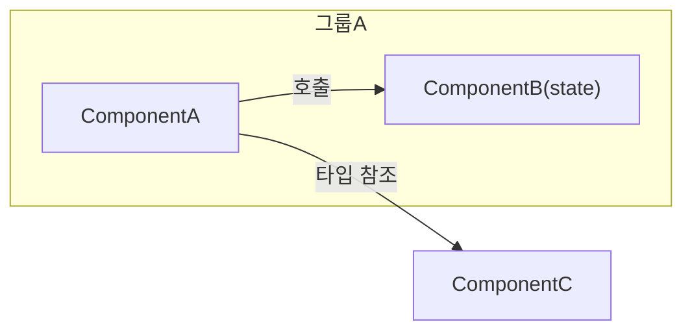
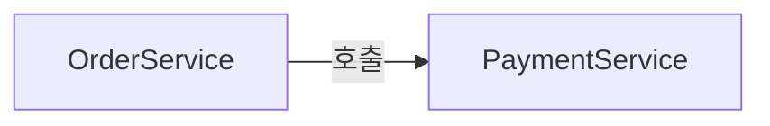

# Generating Architecture Views

## Workflow

1. **Settings** — run the settings script.
2. **Classify** — purpose (Step 1), static or dynamic (Step 1), and initial generation / regeneration / colliding slug ("Output file").
3. **Generate** — Dependency (Step 2), Responsibility (Step 3), Collaboration (Step 4).
4. **Self-check** — AP-1 to AP-15; fix and re-check before going on.
5. **Save and finish** — the steps under "Saving", in order, then reply with the file link.

This skill produces only the architecture view — nothing else, no follow-up offers.

## Scripts

Every script lives in this skill's `scripts/` folder. Find a Python 3.9+ interpreter once per run — `python3`, then `python`, then `py -3` — and run each script by its full path **without changing the working directory** (paths you pass and write stay relative to the project root):

```text
<python> <this skill's directory>/scripts/<script>.py [arguments]
```

Each script prints one result line, plus any `⚙️ 설정 안내: …` notice lines. Collect every notice line (no duplicates) for the end of the chat response.

## Settings

Run `read_settings.py` first, fresh every run. It prints one line of JSON: `values` (every option, already validated and defaulted) and `notices`. Use `values` as this run's settings; never read `settings.jsonc` or `settings.schema.json` yourself, and never edit either.

- **No Python 3.9+, or the script fails**: read only the `default` of every option in `settings.schema.json`, use those, and add `⚙️ 설정 안내: settings.jsonc — 설정 스크립트를 실행하지 못해 모든 값을 기본값으로 사용` to the response.
- **The request itself names a value** for something an option controls (e.g. "이번엔 상자 없이", "Responsibility도 보여줘", "elk로", "hover 빼고"): use it for this request only.

## Step 1 — Purpose and kind

**Purpose**: if it's stated or clearly implied ("새로 합류한 팀원에게 보여주려고" → onboarding; "OrderService 쪽에서 이상한 게 있어서" → troubleshooting), use it without asking. The purpose doesn't change what gets generated, so ask only when you genuinely can't tell, and before anything else:

```text
이 구조 뷰를 어떤 목적으로 보시나요?
1. 온보딩 — 전체 구조를 이해하고 싶다
2. 특정 문제 진단 — 특정 컴포넌트/관계에 집중하고 싶다
3. 기타 — 직접 설명
```

- 1/2 sets the purpose. For 3, ask "어떤 정보가 필요하신지 한 문장으로 알려주세요" and wait.
- An ambiguous answer or no answer: use **온보딩** and say so (e.g. "목적을 명확히 하지 않으셔서 온보딩 기준으로 진행합니다").
- If the description identifies no components at all, don't ask about purpose — ask what process/system to diagram.

**Static or dynamic** (judged fresh every request, regenerations included):

- **Dynamic (structure change)** — the request asks what changed: a commit, PR, diff, before/after of a refactor, "무엇이 추가/변경/삭제됐나". Step 2 marks changed nodes.
- **Static** — everything else; no change marks.

Decide without asking; only if you genuinely can't tell, ask "현재 구조를 보여드릴까요, 변화(추가·변경·삭제)를 표시할까요?"

## Step 2 — Dependency

**Evidence only**: use only components and dependencies the description states or clearly implies — never add one to make the picture feel complete. An arrow joins exactly the two components the description relates; a described chain (A calls B, B calls C) is A→B and B→C, never a shortcut A→C.

**Groups**: use a `subgraph` only when the description gives a real signal — a shared name prefix/namespace or an explicit layer/domain word ("주문 도메인", "인증 계층"). Without one, draw no `subgraph`; all components then count as one unlabeled group for Steps 3–4.

**Caption**: exactly one plain-text line (no blockquote, heading, or bold) between `### Dependency` and the code fence, saying what the diagram depicts, built only from the request's key words — the system/process and the aspect asked about (e.g. "Jetpack Navigation 3에서 백스택과 화면 전환 구조를 보여줘" → `Jetpack Navigation 3의 백스택과 화면 전환 의존 구조`). Write it in the user's language. On regeneration, rewrite it to cover every request so far.

**Diagram** — write only this basic form; `build_diagram.py` adds everything else (config block, edge IDs, colors, section comments, CRUD definitions):



- **Nodes**: declare every node, in the order you introduce it (that order sets its color). A display name that can't be an ID (parentheses, spaces, …) is declared `Id@{ label: "표시 이름" }`.
- **Edges**: `Source -->|관계 성격| Target`. The label is the relationship's nature in the description's own words (호출, 타입 참조, 선언 참조, 화면·타입 참조 … — open vocabulary); if the description doesn't say, use "호출".
- **After the edges**: only `class <Id> crud*` lines (dynamic) and `click` lines. Never write a config block, edge IDs, `classDef` or color `class` lines, `linkStyle`, or `%%` comments.
- **Change marks** (dynamic only) — only nodes the description says were added, changed, or removed; never guess. A removed node keeps the relations the description says it had. No legend.

  | Change | Label | Line after the edges |
  |---|---|---|
  | Added | `Id["✨&nbsp;<b>Name</b>"]` | `class Id crudCreate` |
  | Changed | `Id["♻️&nbsp;Name"]` | `class Id crudUpdate` |
  | Removed | `Id["🗑️&nbsp;<s>Name</s>"]` | `class Id crudDelete` |

- **Links**: `click Id "target" "FileName.kt"` for every node whose target "Hyperlink resolution" finds; no `click` for a node without one. The label is always the target's file name — panel text is the hover script's job.
- **Renderer**: only when the request itself names a Mermaid renderer (e.g. "elk"), note that exact value for `--layout` in "Saving". Otherwise the `dependency.renderer` setting decides; a renderer named in an earlier round never carries over.

### Hyperlink resolution

Resolve once per group/element and use the same target for its `click` and for its Markdown link in Responsibility/Collaboration:

1. **Local project path** given or clearly implied → link relative to `.zenuml/` (`app/src/.../Foo.kt` → `../app/src/.../Foo.kt`). A group links to its members' common parent folder (e.g. `../app/`) when one is evident.
2. **Repository URL** given → link to the file's URL; a group links to the folder's URL.
3. **Neither** → plain text. Never fabricate a path or URL.

Only carry forward locations the description states — never search or read the codebase to find them.

## Step 3 — Responsibility

If `responsibility.display` is `hidden`, skip this step entirely — no section, and skip AP-6/AP-6b.

Every group and every element gets its own entry (except a consolidated set, below), headed by its bold name hyperlinked per "Hyperlink resolution":

- <strong>책임 (추상)</strong>: one sentence, the high-level responsibility, grounded in the description.
- <strong>역할 (구체)</strong>: one sentence citing the actual names/behaviors the description mentions (method calls, fields, sub-parts). Wrap every code-level identifier in backticks (`` `NiaAppState` ``, `` `navigateToTopic()` ``).

If the description doesn't support one of the two levels, write `설명에 명시되지 않음` for that level — never guess, never drop the level.

Order: `#### 그룹의 책임` (only if there are groups), then `#### 요소의 책임`.

**Bold**: in Responsibility and Collaboration, every bold name and field label uses `<strong>…</strong>`, never `**…**` (it must also wrap links: `<strong>[이름](경로)</strong>`).

**Parallel-sibling consolidation**: when **3+** elements in the same group fill the same kind of slot relative to a common relationship (e.g. each is its own route-registration contract called the same way by the same host) and none has a responsibility different in kind — a different name or identifier doesn't count — combine them into one entry. Head it with every member's linked bold name, comma-separated. 책임 (추상) is one shared sentence; 역할 (구체) still cites each member's own identifiers. A member with a real difference in kind gets its own entry. Fewer than 3 qualifying members: no consolidation.

## Step 4 — Collaboration

If `collaboration.display` is `hidden`, skip this step entirely — no section, and skip AP-7–AP-10.

An entry exists only for a pair with a **real dependency** between them:

- **Group level** (only with 2+ groups): one entry per pair of groups with at least one edge crossing between their members. Describe each group only by what the description says about it — never a guessed role (this matters most for structural names like "app 모듈").
- **Element level**: one entry per pair of elements joined directly by an edge, whether in the same group or not (a cross-group edge also feeds its group pair's entry). Write entries in first-appearance order — sources in Dependency order, then each source's targets in edge order — so no pair repeats.

**Format** — the opening line states the real direction, with every name in `<strong>` and linked per "Hyperlink resolution" (at both levels, however many entries): <strong>A</strong>는 <strong>B</strong>에 의존한다, or <strong>A</strong>와 <strong>B</strong>는 서로 의존한다 for both directions — never "vs". Then three sub-parts, each a `<strong>` heading bullet with a **nested** list of 2–4 short, concrete points (never an inline paragraph):

- <strong>책임의 경계</strong>
  - what one side is responsible for
  - what the other side is responsible for
  - where responsibility crosses from one to the other
- <strong>분리 이유 & 합리성 평가</strong>
  - why this wasn't merged into one thing
  - whether that separation still holds up
- <strong>내가 할 수 있는 질문</strong>
  - 2–3 questions worth re-asking when reviewing this boundary later

Inside the nested points, a group/element is mentioned as plain backticked text (no bold, no link), and every code-level identifier is backticked — e.g. "`app`은 어떤 목적지가 존재하는지 결정한다".

Write every entry self-contained — restate both sides in full, never "위와 동일" — and keep later entries as specific as earlier ones.

**Multi-target consolidation**: when one source depends on **3+** targets in the same group, with the same relationship nature, each filling the same kind of slot (e.g. each an individual channel sender), make one entry whose target side is a collective phrase (e.g. "feature 내비게이션 요소들"). Separate edges elsewhere or different names don't disqualify a target; only a responsibility or relationship different in kind does — that target keeps its own entry. 2 or fewer targets, mixed groups, or mixed natures: list each by name (two joined with "와"/"과").

**Scale**: never invent or split components, groups, or dependencies to change a count. If a section is still long after consolidation, write it in full — no truncation, no length notice.

## Self-check (AP-1–AP-15)

Check the draft against every item; fix and re-check before saving. Don't narrate this to the user.

- AP-1: No component beyond the description.
- AP-2: No dependency beyond the description; no chain collapsed into a shortcut edge.
- AP-3: No `subgraph` without a naming/layer/domain signal.
- AP-4: Every edge label is grounded in the description, or "호출" when it's silent.
- AP-5: The diagram is in the basic form (Step 2, "Diagram").
- AP-5b: `--layout` is planned exactly when this request named a renderer.
- AP-5c: Static → no change marks; dynamic → exactly the nodes the description names carry the matching prefix and `class … crud*` line.
- AP-6: Every group and element has 책임 (추상) and 역할 (구체), or `설명에 명시되지 않음`; identifiers in 역할 (구체) are backticked.
- AP-6b: Responsibility consolidation only where its condition holds, every member linked and cited.
- AP-7: Group-level entries only for group pairs with a crossing edge (none with fewer than 2 groups).
- AP-8: Element-level entries only for directly connected pairs.
- AP-9: Multi-target consolidation only where its condition holds.
- AP-10: Every Collaboration entry has the directional opening line, all three sub-parts as nested lists, and backticked identifiers.
- AP-11: No comparison of concepts that aren't identified groups/elements.
- AP-12: Every entry self-contained, none thinner than earlier ones.
- AP-13: Every link follows "Hyperlink resolution", none fabricated, and each name carries the same link everywhere it heads an entry or opening line — spot-check the element-level Collaboration entries.
- AP-13b: Exactly one caption, from the request's key words only.
- AP-13c: The file and the chat response hold only what "Output file" allows.
- AP-13d: Each of Responsibility/Collaboration matches its display setting (or the request's override).
- AP-14: Request classification matches the file and log writes; nothing is saved if Steps 2–4 didn't complete.
- AP-15: No sequence/runtime-flow diagram, and no offer to make one.

## Output file

**Where**: `.zenuml/<slug>.architecture.md`, `<slug>` a short kebab-case name for what the view is about. In `.zenuml/`, write only `*.architecture.md` files and their logs.

**Classify the request**: (1) *regeneration* — a follow-up refining the view just shown — overwrites that file completely; (2) *initial generation* creates a new file; (3) an unrelated request whose slug collides with an existing file gets `-2`, `-3`, …; (4) if you can't tell which, ask.

**Contents, in this order**: `### Dependency` (caption, then the code fence), `### Responsibility`, `### Collaboration` — always `###`. A `hidden` section is absent. In Collaboration, `#### 그룹 간 비교` (with 2+ groups) comes before `#### 요소 간 비교`.

**Section display**: Dependency is never boxed. For Responsibility and Collaboration, `plain` writes the section as is; `collapsed` puts everything under the heading in a box like this — the summary is always `Details`, with the blank lines kept so the Markdown inside renders — and `expanded` is the same with `<details open>`:

```markdown
### Responsibility

<details>
<summary>Details</summary>

…the section's content, unchanged…

</details>
```

**Nothing but content**: besides the headings, caption, boxes, and section content, the file holds only what the scripts add. Never add meta commentary in any form — renderer warnings, layout explanations, notes on how the view was built, length notices, link-behavior notes.

**Chat response**: only the file link, relative to the project root —

📄 [<slug> 구조 뷰](.zenuml/<slug>.architecture.md)

— plus, only when they apply: a clarifying question (Step 1, or no identifiable components), the onboarding-default notice, the notice lines from the scripts, and the `⚙️ … 건너뜀` lines from "Saving". Never paste the sections into the chat.

**No filesystem**: put the three sections directly in the chat response instead, and skip "Saving".

## Saving

Only for a finished view — if the request ended in a clarifying question, save nothing. After the self-check passes, in this order:

1. **Write** `.zenuml/<slug>.architecture.md`.
2. **Diagram**: run `build_diagram.py <path to the file>` (add `--layout=<value>` only if the request named a renderer). It completes the diagram in place. No Python or non-zero exit: leave the file as is and add `⚙️ 다이어그램 서식 건너뜀: <the script's message, or Python 3.9 이상을 찾지 못함>`.
3. **Log**: append this round to `<log.directory>/<slug>.architecture.md` (resolved from the project root; create the folder if needed) — see "Feedback log".
4. **Hover**: if hover is on, run `apply_hover.py <path to the file>` — see "Hover panels".
5. **Reply** with the file link.

### Feedback log

Use the file's content as it is after step 2 — the hover script hasn't run yet, so the log never contains panel text. Initial generation (or a colliding slug) starts a fresh log with Round 1; regeneration appends Round N and never changes earlier rounds:

````markdown
## Round N — <ISO date>
**Request**: <this round's request>

**Response**:
<the file's content after the diagram script>
````

**Request** gathers every turn since the previous round (for Round 1, since this view's conversation began) that shaped what got built — including the Step 1 purpose exchange — lightly edited into one entry; leave out unrelated talk.

Never summarize, analyze, or prune the log. Changing `log.directory` never moves or deletes old logs; a regeneration continues at the current location (a fresh Round 1 if none exists there). Leave `.gitignore` alone. If other work cites a specific log as a source, stage just that file with `git add -f <path>`.

### Hover panels

In VS Code's Markdown preview, hovering a Dependency node shows a panel with that node's Responsibility and the collaborations it depends on — copied from the file's body by `apply_hover.py`, never written by you.

**On**: `hover.enabled` is `true` and at least one of `hover.responsibility`/`hover.collaboration` is non-empty, after applying any value the request states ("hover 빼고", "질문도 넣어줘", "노드 아래에 띄워줘"). Off: don't run the script.

**Run**: `apply_hover.py <path to the file> [--enabled=…] [--responsibility=…] [--collaboration=…] [--position=…]`, adding an option only for a value the request itself states (e.g. `--collaboration=targets,boundary,rationale,questions`, `--position=node`, `--responsibility=` for none).

- No Python 3.9+: add `⚙️ hover 건너뜀: Python 3.9 이상을 찾지 못함`; the view still counts as done.
- Non-zero exit: leave the file as is and add one line saying hover couldn't be applied, with the script's message.

**Re-syncing**: when the user only asks to refresh the hover panels of an existing view (e.g. after editing its body), just run the script on that file (options only for values the request states) and reply with the link — no regeneration, no log round.

## Out-of-scope requests

- **Class, deployment, or any other kind of structural diagram**: say this skill produces only Dependency, Responsibility, and Collaboration; no workaround.
- **Sequence diagrams, call order, runtime/behavior flow**: say this skill produces only structural views; don't draw one or suggest another tool.
- **Building the view from an actual codebase**: this skill takes a natural-language description only. If real code is available, read it first (directly, or via Explore/Grep/gh), distill a description that cites concrete evidence (file paths, identifiers, repository URLs, commit/PR references — which "Hyperlink resolution" needs), then use that description as input.
- **Comparing concepts that aren't identified groups/elements** (e.g. "Controller vs Application 패턴이 뭐가 다른가요?" with no such components): say Collaboration compares only groups/elements identified from the description.

## Example

Input: "OrderService는 주문을 생성하고, PaymentService는 결제를 담당하며, OrderService가 PaymentService를 호출한다. 이 시스템의 구조를 보여줘." Purpose: 온보딩. No grouping signal, so no `subgraph`; no paths or URLs, so no links. What you write (both display settings `plain`; `build_diagram.py` then completes the fence):

````markdown
### Dependency

OrderService와 PaymentService의 주문·결제 의존 구조



### Responsibility

#### 요소의 책임

- <strong>OrderService</strong>
  - <strong>책임 (추상)</strong>: 주문 생성을 담당한다.
  - <strong>역할 (구체)</strong>: 주문을 생성하는 처리를 수행한다.
- <strong>PaymentService</strong>
  - <strong>책임 (추상)</strong>: 결제를 담당한다.
  - <strong>역할 (구체)</strong>: 결제 처리를 수행한다.

### Collaboration

#### 요소 간 비교

- <strong>OrderService</strong>는 <strong>PaymentService</strong>에 의존한다.
  - <strong>책임의 경계</strong>
    - `OrderService`는 주문 생성을 책임진다.
    - `PaymentService`는 결제 처리를 책임진다.
    - 경계는 `OrderService`가 결제가 필요한 시점에 `PaymentService`를 호출하는 지점이다.
  - <strong>분리 이유 & 합리성 평가</strong>
    - 주문 생성과 결제 처리를 하나로 합치지 않아 각자의 변경 이유를 분리한다.
    - 두 책임이 서로 다른 이유로 바뀔 수 있다면 합리적인 분리다.
  - <strong>내가 할 수 있는 질문</strong>
    - `OrderService`가 결제 처리 세부사항까지 알고 있지는 않은가?
    - `PaymentService`가 주문 생성 로직에 역으로 의존하고 있지는 않은가?
````

More examples (groups, multi-target consolidation, all three link modes): `references/examples.md`. Section shapes: `references/templates.md`.
