# hover 툴팁 테스트

VS Code Markdown 미리보기에서 Mermaid 노드에 마우스를 올렸을 때 Responsibility·Collaboration 요약이 상세 패널로 뜨는지 확인하는 테스트입니다.

## 준비

로컬 `.vscode/settings.json`(저장소에서는 gitignore 대상)에 아래를 추가하고, 미리보기를 닫았다 다시 엽니다.

```json
{
  "markdown.styles": ["docs/hover-tooltip-test/mermaid-tooltip.css"]
}
```

## 확인할 것

1. 노드에 마우스를 올리면 툴팁이 뜨는가
2. 툴팁이 미리보기 아래쪽에 가로로 넓게(높이 최대 45%) 뜨고, 다이어그램을 위쪽에 두었을 때 노드를 가리지 않는가
3. `<b>`, `<code>`, `<br/>` 서식이 적용되는가
4. 오른쪽 아래 노드(`NotificationSender`)의 툴팁도 잘리지 않는가
5. 노드를 클릭하면 `click`에 지정한 파일로 이동하는가
6. (비교용) CSS 설정을 빼면 기본 200px 툴팁이 노드 아래에 뜨는가
7. 링크가 없는 노드(`AuditLog`)도 툴팁이 뜨고, 클릭해도 이동하거나 오류가 나지 않는가

```mermaid
flowchart LR
  subgraph Order["주문"]
    direction TB
    OrderController
    OrderService
  end
  subgraph Payment["결제"]
    direction TB
    PaymentService
    NotificationSender
  end
  AuditLog

  OrderController e0@-->|호출| OrderService
  OrderService e1@-->|호출| PaymentService
  PaymentService e2@-->|호출| NotificationSender
  OrderService e3@-->|기록| AuditLog

  classDef controllerNode stroke:#E69F00,stroke-width:3px
  class OrderController controllerNode
  classDef orderNode stroke:#56B4E9,stroke-width:3px
  class OrderService orderNode
  classDef paymentNode stroke:#009E73,stroke-width:3px
  class PaymentService paymentNode
  classDef notifyNode stroke:#0072B2,stroke-width:3px
  class NotificationSender notifyNode
  classDef auditNode stroke:#D55E00,stroke-width:3px,cursor:auto
  class AuditLog auditNode

  classDef controllerEdge stroke:#E69F00,stroke-width:3.5px
  class e0 controllerEdge
  classDef orderEdge stroke:#56B4E9,stroke-width:3.5px
  class e1 orderEdge
  class e3 orderEdge
  classDef paymentEdge stroke:#009E73,stroke-width:3.5px
  class e2 paymentEdge

  click OrderController "../../README.md" "<b>책임 (추상)</b>: 주문 요청을 받아 서비스로 넘긴다<br/><b>역할 (구체)</b>: <code>POST /orders</code>를 받아 <code>OrderService.create()</code>를 호출<br/><br/><b>→ OrderService (호출)</b><br/>• 책임의 경계: 입력 검증까지만 하고 주문 규칙은 모른다<br/>• 분리 이유: HTTP 계층 교체가 주문 규칙에 영향 없음"
  click OrderService "../../README.md" "<b>책임 (추상)</b>: 주문을 생성하고 결제를 요청한다<br/><b>역할 (구체)</b>: <code>create()</code>로 주문을 저장하고 <code>PaymentService.pay()</code>를 호출<br/><br/><b>← OrderController (호출)</b><br/><b>→ PaymentService (호출)</b><br/>• 책임의 경계: 주문 상태는 OrderService만 바꾼다<br/>• 분리 이유: 결제 수단 교체가 주문에 영향 없음<br/>• 질문: 결제 실패 시 주문 상태는 누가 되돌리나?"
  click PaymentService "../../README.md" "<b>책임 (추상)</b>: 결제를 처리한다<br/><b>역할 (구체)</b>: <code>pay()</code>로 PG 승인 후 결과를 알림으로 넘긴다<br/><br/><b>← OrderService (호출)</b><br/><b>→ NotificationSender (호출)</b><br/>• 책임의 경계: 알림 채널은 모른다<br/>• 분리 이유: 알림 채널 추가가 결제 로직을 건드리지 않음"
  click NotificationSender "../../README.md" "<b>책임 (추상)</b>: 결제 결과를 사용자에게 알린다<br/><b>역할 (구체)</b>: <code>send()</code>로 메일·푸시 발송<br/><br/><b>← PaymentService (호출)</b><br/>• 긴 내용 테스트: 이 노드는 다이어그램 오른쪽 아래에 있어서, CSS가 적용되지 않으면 툴팁이 미리보기 오른쪽이나 아래 끝에서 잘릴 수 있다. CSS가 적용되면 패널 아래쪽에 고정되어 끝까지 보여야 한다.<br/>• 줄 1<br/>• 줄 2<br/>• 줄 3<br/>• 줄 4<br/>• 줄 5<br/>• 줄 6<br/>• 줄 7<br/>• 줄 8"
  click AuditLog noHoverLink "<b>책임 (추상)</b>: 주문 이력을 남긴다<br/><br/><b>← OrderService (기록)</b><br/>(링크 없는 노드 — 클릭해도 이동하지 않아야 함)"
```


