# hover 툴팁 테스트 (md 단독)

CSS 파일이나 `markdown.styles` 설정 없이, 이 파일 안의 `<style>` 블록만으로 툴팁이 상세 패널로 바뀌는지 확인합니다. `.vscode/settings.json`에 `markdown.styles`를 넣었다면 빼고 확인하세요.

확인할 것:

1. VS Code: 노드에 마우스를 올리면 미리보기 아래쪽에 넓은 패널이 뜨는가

```mermaid
flowchart LR
  subgraph Order["주문"]
    direction TB
    OrderController
    OrderService
  end
  subgraph Payment["결제"]
    direction TB
    PaymentService
    NotificationSender
  end

  OrderController e0@-->|호출| OrderService
  OrderService e1@-->|호출| PaymentService
  PaymentService e2@-->|호출| NotificationSender

  classDef controllerNode stroke:#E69F00,stroke-width:3px
  class OrderController controllerNode
  classDef orderNode stroke:#56B4E9,stroke-width:3px
  class OrderService orderNode
  classDef paymentNode stroke:#009E73,stroke-width:3px
  class PaymentService paymentNode
  classDef notifyNode stroke:#0072B2,stroke-width:3px
  class NotificationSender notifyNode

  classDef controllerEdge stroke:#E69F00,stroke-width:3.5px
  class e0 controllerEdge
  classDef orderEdge stroke:#56B4E9,stroke-width:3.5px
  class e1 orderEdge
  classDef paymentEdge stroke:#009E73,stroke-width:3.5px
  class e2 paymentEdge

  click OrderController "../../README.md" "<b>책임 (추상)</b>: 주문 요청을 받아 서비스로 넘긴다<br/><b>역할 (구체)</b>: <code>POST /orders</code>를 받아 <code>OrderService.create()</code>를 호출<br/><br/><b>→ OrderService (호출)</b><br/>• 책임의 경계: 입력 검증까지만 하고 주문 규칙은 모른다<br/>• 분리 이유: HTTP 계층 교체가 주문 규칙에 영향 없음"
  click OrderService "../../README.md" "<b>책임 (추상)</b>: 주문을 생성하고 결제를 요청한다<br/><b>역할 (구체)</b>: <code>create()</code>로 주문을 저장하고 <code>PaymentService.pay()</code>를 호출<br/><br/><b>← OrderController (호출)</b><br/><b>→ PaymentService (호출)</b><br/>• 책임의 경계: 주문 상태는 OrderService만 바꾼다<br/>• 분리 이유: 결제 수단 교체가 주문에 영향 없음<br/>• 질문: 결제 실패 시 주문 상태는 누가 되돌리나?"
  click PaymentService "../../README.md" "<b>책임 (추상)</b>: 결제를 처리한다<br/><b>역할 (구체)</b>: <code>pay()</code>로 PG 승인 후 결과를 알림으로 넘긴다<br/><br/><b>← OrderService (호출)</b><br/><b>→ NotificationSender (호출)</b><br/>• 책임의 경계: 알림 채널은 모른다<br/>• 분리 이유: 알림 채널 추가가 결제 로직을 건드리지 않음"
  click NotificationSender "../../README.md" "<b>책임 (추상)</b>: 결제 결과를 사용자에게 알린다<br/><b>역할 (구체)</b>: <code>send()</code>로 메일·푸시 발송<br/><br/><b>← PaymentService (호출)</b><br/>• 긴 내용 테스트: 이 노드는 다이어그램 오른쪽 아래에 있어서, CSS가 적용되지 않으면 툴팁이 미리보기 오른쪽이나 아래 끝에서 잘릴 수 있다. CSS가 적용되면 패널 아래쪽에 고정되어 끝까지 보여야 한다.<br/>• 줄 1<br/>• 줄 2<br/>• 줄 3<br/>• 줄 4<br/>• 줄 5<br/>• 줄 6<br/>• 줄 7<br/>• 줄 8"
```

2. GitHub: 맨 위 `<style>` 블록의 CSS 내용이 본문에 글자로 드러나지 않는가

