# hover 툴팁 테스트 (노드 아래, 폭 25em)

`hoverPosition: node`의 A+안(중간 폭)입니다. 위치·배경은 Mermaid 기본 그대로이고, 왼쪽 정렬로 바꾸고 폭을 `25em`(글자 크기 12px에서 약 300px, 한글 한 줄 약 25자)으로 넓혔습니다. 툴팁이 미리보기 오른쪽으로 넘칠 때만 오른쪽 끝에 붙어 같은 폭을 유지합니다(`position-try-fallbacks`). `.vscode/settings.json`에 `markdown.styles`를 넣었다면 빼고 확인하세요.

확인할 것:

1. VS Code: 노드에 마우스를 올리면 그 노드 바로 아래에 툴팁이 뜨는가
2. VS Code: 링크가 있든 없든 노드에 마우스를 올리면 노드 이름에 밑줄이 생기는가
3. VS Code: 링크가 없는 노드(`AuditLog`)도 툴팁이 뜨고, 클릭해도 이동하거나 오류가 나지 않는가
4. VS Code: 긴 툴팁(`NotificationSender`)이 A안(200px)·33em안(약 400px)과 비교해 읽기 편한가
5. VS Code: 오른쪽 끝 노드(`NotificationSender`)의 툴팁도 왼쪽 노드와 같은 폭으로 뜨고, 미리보기 오른쪽 끝에 붙어 잘리지 않는가
6. VS Code: 오른쪽 끝 노드를 hover한 다음 왼쪽 노드를 hover해도, 왼쪽 노드의 툴팁이 그 노드 아래에 뜨는가

```mermaid
flowchart LR
  subgraph Order["주문"]
    direction TB
    OrderController
    OrderService
  end
  subgraph Payment["결제"]
    direction TB
    PaymentService
    NotificationSender
  end
  AuditLog

  OrderController e0@-->|호출| OrderService
  OrderService e1@-->|호출| PaymentService
  PaymentService e2@-->|호출| NotificationSender
  OrderService e3@-->|기록| AuditLog

  classDef controllerNode stroke:#E69F00,stroke-width:3px
  class OrderController controllerNode
  classDef orderNode stroke:#56B4E9,stroke-width:3px
  class OrderService orderNode
  classDef paymentNode stroke:#009E73,stroke-width:3px
  class PaymentService paymentNode
  classDef notifyNode stroke:#0072B2,stroke-width:3px
  class NotificationSender notifyNode
  classDef auditNode stroke:#D55E00,stroke-width:3px,cursor:auto
  class AuditLog auditNode

  classDef controllerEdge stroke:#E69F00,stroke-width:3.5px
  class e0 controllerEdge
  classDef orderEdge stroke:#56B4E9,stroke-width:3.5px
  class e1 orderEdge
  class e3 orderEdge
  classDef paymentEdge stroke:#009E73,stroke-width:3.5px
  class e2 paymentEdge

  click OrderController "../../README.md" "<b>OrderController</b><br/><b>책임 (추상)</b>: 주문 요청을 받아 서비스로 넘긴다<br/><b>역할 (구체)</b>: <code>POST /orders</code>를 받아 <code>OrderService.create()</code>를 호출<br/><br/><b>OrderService에 의존한다 (호출)</b><br/>• 책임의 경계: 입력 검증까지만 하고 주문 규칙은 모른다<br/>• 분리 이유: HTTP 계층 교체가 주문 규칙에 영향 없음"
  click OrderService "../../README.md" "<b>OrderService</b><br/><b>책임 (추상)</b>: 주문을 생성하고 결제를 요청한다<br/><b>역할 (구체)</b>: <code>create()</code>로 주문을 저장하고 <code>PaymentService.pay()</code>를 호출<br/><br/><b>PaymentService에 의존한다 (호출)</b><br/>• 책임의 경계: 주문 상태는 OrderService만 바꾼다<br/>• 분리 이유: 결제 수단 교체가 주문에 영향 없음<br/>• 질문: 결제 실패 시 주문 상태는 누가 되돌리나?"
  click PaymentService "../../README.md" "<b>PaymentService</b><br/><b>책임 (추상)</b>: 결제를 처리한다<br/><b>역할 (구체)</b>: <code>pay()</code>로 PG 승인 후 결과를 알림으로 넘긴다<br/><br/><b>NotificationSender에 의존한다 (호출)</b><br/>• 책임의 경계: 알림 채널은 모른다<br/>• 분리 이유: 알림 채널 추가가 결제 로직을 건드리지 않음"
  click NotificationSender "../../README.md" "<b>NotificationSender</b><br/><b>책임 (추상)</b>: 결제 결과를 사용자에게 알린다<br/><b>역할 (구체)</b>: <code>send()</code>로 메일·푸시 발송<br/><br/>• 긴 내용 테스트: 이 노드는 다이어그램 오른쪽 아래에 있어서, CSS가 적용되지 않으면 툴팁이 미리보기 오른쪽이나 아래 끝에서 잘릴 수 있다. CSS가 적용되면 패널 아래쪽에 고정되어 끝까지 보여야 한다.<br/>• 줄 1<br/>• 줄 2<br/>• 줄 3<br/>• 줄 4<br/>• 줄 5<br/>• 줄 6<br/>• 줄 7<br/>• 줄 8"
  click AuditLog noHoverLink "<b>AuditLog</b><br/><b>책임 (추상)</b>: 주문 이력을 남긴다<br/><br/>(링크 없는 노드 — 클릭해도 이동하지 않아야 함)"
```

