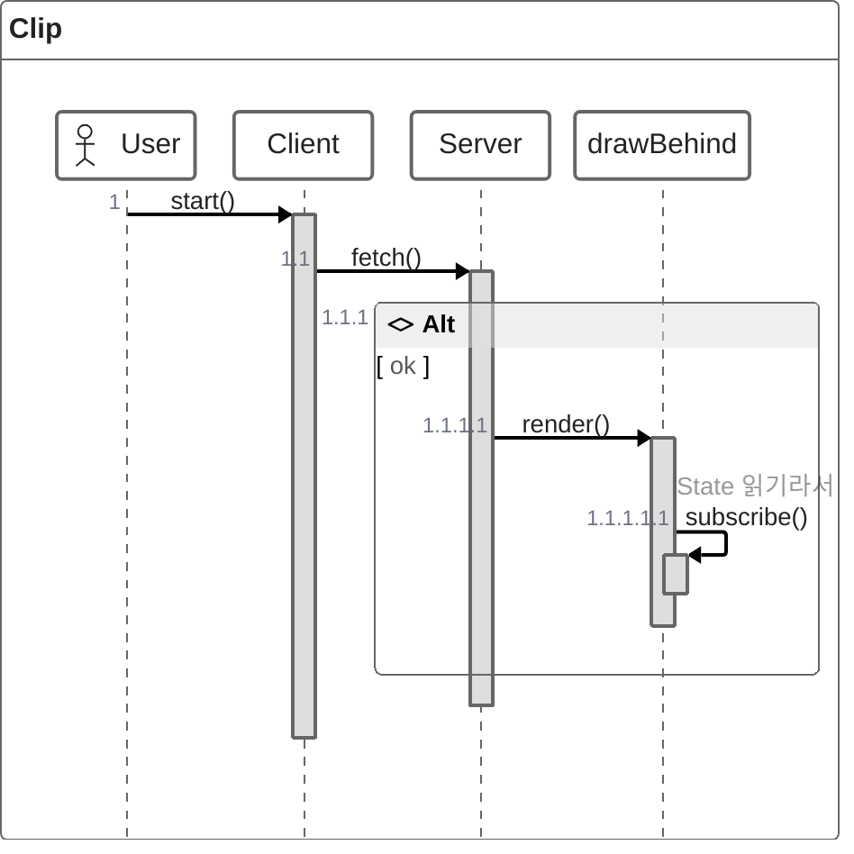
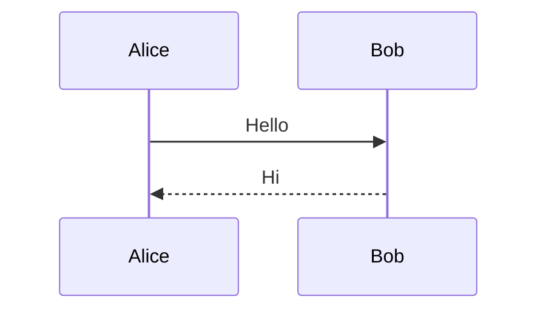

# Quickstart: 다이어그램 가장자리 잘림 수정 검증

## 준비

```sh
SK=.claude/skills/exporting-markdown-diagrams/scripts
(cd $SK && npm install)   # 이미 설치돼 있으면 생략
```

재현 샘플 `clip.md`(임시 위치 아무 데나) — 가장 오른쪽 참여자에 긴 주석이 붙은 zenuml + 일반 mermaid:

````markdown



````

## 시나리오 1 — 잘림 해소 (US1, SC-001)

```sh
for f in svg png pdf; do node $SK/export-diagrams.js clip.md $f; done
```

- 기대: 각 형식마다 `exports/clip-1.*`, `exports/clip-2.*` 두 줄 출력.
- `exports/clip-1.png`를 열어 주석 끝("…꽤 길다")까지 보이는지 확인.
- `exports/clip-1.svg`의 루트 `viewBox` 폭이 수정 전(473.5)보다 넓은지 확인.
- `exports/clip-1.pdf`가 1페이지이고 주석 텍스트를 선택할 수 있는지 확인.

## 시나리오 2 — PNG 크기 (SC-004)

- `exports/clip-2.png`(폭 450 viewBox) → 1350px 폭.
- 넓은 다이어그램(예: `.zenuml/navigation3.md`, viewBox 폭 1357) → PNG 폭 4071px(기존 2352px).

## 시나리오 3 — 문서 전체 PDF (US2, SC-003)

```sh
node $SK/export-document-pdf.js clip.md "" --layout single
node $SK/export-document-pdf.js clip.md "" --layout paginated
```

- 기대: 두 경우 모두 오류 없이 PDF 경로 출력, 삽입 다이어그램 주석 전문이 보임.

## 시나리오 4 — 회귀 없음 (SC-002)

수정 전 커밋의 스크립트로 `.zenuml/*.md`를 SVG로 뽑아 둔 뒤(예: `git stash` 또는 `git worktree`), 수정 후 스크립트 출력과 `cmp`로 비교한다. 넘침이 없는 다이어그램은 전부 바이트 동일해야 한다.
