### Dependency

쇼핑몰 주문·결제·알림 의존 구조

```mermaid
---
config:
  layout: elk
  flowchart:
    curve: basis
    nodeSpacing: 45
    rankSpacing: 70
    titleTopMargin: 25
  themeCSS: ".cluster-label text { font-size: 20px !important; font-weight: 700 !important; } .edgeLabel, .edgeLabel p { background-color: transparent !important; } .labelBkg { background-color: color-mix(in srgb, var(--vscode-editor-background, #ffffff) 70%, transparent) !important; }"
---
flowchart LR
  subgraph Order["주문"]
    direction TB
    OrderController
    OrderService
    CartStore@{ label: "class&nbsp;CartStore" }
  end
  subgraph Payment["결제"]
    direction TB
    PaymentService
    PgClient
    FraudChecker
  end
  subgraph Notify["알림 채널"]
    direction TB
    NotificationHub
    EmailSender
    SmsSender
    PushSender
  end
  InventoryService
  AuditLog

  %% ---- 엣지 ----
  OrderController e0@-->|호출| OrderService
  OrderController e1@-->|상태 참조| CartStore
  OrderService e2@-->|호출| PaymentService
  OrderService e3@-->|재고 확인| InventoryService
  InventoryService e4@-->|재고 변경 통지| OrderService
  PaymentService e5@-->|호출| PgClient
  PaymentService e6@-->|호출| FraudChecker
  PaymentService e7@-->|호출| NotificationHub
  NotificationHub e8@-->|호출| EmailSender
  NotificationHub e9@-->|호출| SmsSender
  NotificationHub e10@-->|호출| PushSender
  OrderService e11@-->|기록| AuditLog

  %% ---- 노드 스타일 ----
  classDef orderControllerNode stroke:#E69F00,stroke-width:3px
  class OrderController orderControllerNode
  classDef orderServiceNode stroke:#56B4E9,stroke-width:3px
  class OrderService orderServiceNode
  classDef cartStoreNode stroke:#009E73,stroke-width:3px
  class CartStore cartStoreNode
  classDef paymentServiceNode stroke:#0072B2,stroke-width:3px
  class PaymentService paymentServiceNode
  classDef pgClientNode stroke:#D55E00,stroke-width:3px
  class PgClient pgClientNode
  classDef fraudCheckerNode stroke:#CC79A7,stroke-width:3px
  class FraudChecker fraudCheckerNode
  classDef notificationHubNode stroke:#E69F00,stroke-width:3px
  class NotificationHub notificationHubNode
  classDef emailSenderNode stroke:#56B4E9,stroke-width:3px
  class EmailSender emailSenderNode
  classDef smsSenderNode stroke:#009E73,stroke-width:3px
  class SmsSender smsSenderNode
  classDef pushSenderNode stroke:#0072B2,stroke-width:3px
  class PushSender pushSenderNode
  classDef inventoryServiceNode stroke:#D55E00,stroke-width:3px,cursor:auto
  class InventoryService inventoryServiceNode
  classDef auditLogNode stroke:#CC79A7,stroke-width:3px,cursor:auto
  class AuditLog auditLogNode

  %% ---- 엣지 스타일 (출발 노드 색과 동일) ----
  classDef orderControllerEdge stroke:#E69F00,stroke-width:3.5px
  class e0 orderControllerEdge
  class e1 orderControllerEdge
  classDef orderServiceEdge stroke:#56B4E9,stroke-width:3.5px
  class e2 orderServiceEdge
  class e3 orderServiceEdge
  class e11 orderServiceEdge
  classDef inventoryServiceEdge stroke:#D55E00,stroke-width:3.5px
  class e4 inventoryServiceEdge
  classDef paymentServiceEdge stroke:#0072B2,stroke-width:3.5px
  class e5 paymentServiceEdge
  class e6 paymentServiceEdge
  class e7 paymentServiceEdge
  classDef notificationHubEdge stroke:#E69F00,stroke-width:3.5px
  class e8 notificationHubEdge
  class e9 notificationHubEdge
  class e10 notificationHubEdge

  %% ---- CRUD 표시 (테두리 색은 건드리지 않음) ----
  %% 라벨: ✨&nbsp;<b>추가</b> · ♻️&nbsp;변경 · 🗑️&nbsp;<s>삭제</s>
  classDef crudCreate stroke-width:5px
  classDef crudUpdate stroke-dasharray:12 4 2 4
  classDef crudDelete stroke-dasharray:5 10,color:#6B7280

  click OrderController "../app/order/OrderController.kt" "<b>OrderController</b><br/><b>책임 (추상)</b>: 주문 요청을 받아 서비스로 넘긴다.<br/><b>역할 (구체)</b>: <code>POST /orders</code>를 받아 &quot;장바구니 확정&quot; 단계를 거친 뒤 <code>OrderService.create()</code>를 호출한다.<br/><br/><b>OrderService에 의존한다 (호출)</b><br/><b>책임의 경계</b>: <code>OrderController</code>는 요청을 받는다. <code>OrderService</code>는 주문 규칙을 안다.<br/><b>분리 이유 &amp; 합리성 평가</b>: HTTP 계층이 바뀌어도 주문 규칙은 그대로다.<br/><b>내가 할 수 있는 질문</b>: 입력 검증은 어디서 하는가? &quot;장바구니 확정&quot;은 누구의 책임인가?<br/><br/><b>CartStore에 의존한다 (상태 참조)</b><br/><b>책임의 경계</b>: <code>OrderController</code>는 상태를 읽는다. <code>CartStore</code>는 상태를 들고 있다.<br/><b>분리 이유 &amp; 합리성 평가</b>: 상태 보관과 요청 처리를 나눴다.<br/><b>내가 할 수 있는 질문</b>: 상태를 직접 바꾸지는 않는가?"
  click OrderService "../app/order/OrderService.kt" "<b>OrderService</b><br/><b>책임 (추상)</b>: 주문을 만들고 결제를 요청한다.<br/><b>역할 (구체)</b>: <code>create()</code>가 <code>List&lt;OrderLine&gt;</code>을 저장하고 <code>PaymentService.pay()</code>를 호출한다.<br/><br/><b>InventoryService와 서로 의존한다 (재고 확인)</b><br/><b>책임의 경계</b>: <code>OrderService</code>는 재고를 확인한다. <code>InventoryService</code>는 재고 변경을 알린다.<br/><b>분리 이유 &amp; 합리성 평가</b>: 재고는 다른 소비자도 쓴다. 서로 의존하므로 경계가 흐려질 수 있다.<br/><b>내가 할 수 있는 질문</b>: 통지를 이벤트로 바꿀 수 있는가?<br/><br/><b>PaymentService에 의존한다 (호출)</b><br/><b>책임의 경계</b>: <code>OrderService</code>는 결제를 요청한다. <code>PaymentService</code>는 승인한다.<br/><b>분리 이유 &amp; 합리성 평가</b>: 결제 수단 교체가 주문에 영향 없다.<br/><b>내가 할 수 있는 질문</b>: 결제 실패 시 주문 상태는 누가 되돌리는가?<br/><br/><b>AuditLog에 의존한다 (기록)</b><br/><b>책임의 경계</b>: <code>OrderService</code>는 이력을 넘긴다. <code>AuditLog</code>는 이력을 남긴다.<br/><b>분리 이유 &amp; 합리성 평가</b>: 감사 요구가 바뀌어도 주문은 그대로다.<br/><b>내가 할 수 있는 질문</b>: 기록 실패가 주문을 막는가?"
  click CartStore "../app/order/CartStore.kt" "<b>CartStore</b><br/><b>책임 (추상)</b>: 장바구니 상태를 들고 있다.<br/><b>역할 (구체)</b>: <code>items</code> 상태를 <code>OrderController</code>에 제공한다."
  click PaymentService "https://github.com/example/shop/blob/main/payment/PaymentService.kt" "<b>PaymentService</b><br/><b>책임 (추상)</b>: 결제를 승인한다.<br/><b>역할 (구체)</b>: <code>pay()</code>가 PG 연동 문서의 절차대로 <code>PgClient</code>를 호출하고 결과를 <code>NotificationHub</code>에 넘긴다.<br/><br/><b>PgClient와 FraudChecker에 의존한다 (호출)</b><br/><b>책임의 경계</b>: <code>PaymentService</code>는 승인 절차를 정한다. <code>PgClient</code>는 통신을, <code>FraudChecker</code>는 판정을 맡는다.<br/><b>분리 이유 &amp; 합리성 평가</b>: PG 교체와 판정 기준 변경을 따로 할 수 있다.<br/><b>내가 할 수 있는 질문</b>: 판정은 승인 전에만 하는가?<br/><br/><b>NotificationHub에 의존한다 (호출)</b><br/><b>책임의 경계</b>: <code>PaymentService</code>는 결과를 만든다. <code>NotificationHub</code>는 결과를 보낸다.<br/><b>분리 이유 &amp; 합리성 평가</b>: 채널이 늘어도 결제는 그대로다.<br/><b>내가 할 수 있는 질문</b>: 알림을 비동기로 보내는가?"
  click PgClient "../app/payment/PgClient.kt" "<b>PgClient</b><br/><b>책임 (추상)</b>: 외부 PG와 통신한다.<br/><b>역할 (구체)</b>: <code>approve()</code>로 승인 요청을 보낸다."
  click FraudChecker "../app/payment/FraudChecker.kt" "<b>FraudChecker</b><br/><b>책임 (추상)</b>: 이상 거래를 걸러 낸다.<br/><b>역할 (구체)</b>: <code>check()</code>가 점수 &gt; 80이면 거절한다."
  click NotificationHub "../app/notify/NotificationHub.kt" "<b>NotificationHub</b><br/><b>책임 (추상)</b>: 알림을 채널별로 나눠 보낸다.<br/><b>역할 (구체)</b>: <code>dispatch()</code>가 사용자 설정에 맞는 발송 요소를 고른다.<br/><br/><b>알림 채널 발송 요소들에 의존한다 (호출)</b><br/><b>책임의 경계</b>: <code>NotificationHub</code>는 채널을 고른다. 각 발송 요소는 한 채널로 보낸다.<br/><b>분리 이유 &amp; 합리성 평가</b>: 채널 추가가 허브를 건드리지 않는다.<br/><b>내가 할 수 있는 질문</b>: 새 채널을 추가할 때 허브를 고쳐야 하는가?"
  click EmailSender "../app/notify/EmailSender.kt" "<b>EmailSender</b><br/><b>책임 (추상)</b>: 한 채널로 알림을 보낸다.<br/><b>역할 (구체)</b>: <code>EmailSender.send()</code>는 메일, <code>SmsSender.send()</code>는 문자, <code>PushSender.send()</code>는 푸시를 보낸다."
  click SmsSender "../app/notify/SmsSender.kt" "<b>SmsSender</b><br/><b>책임 (추상)</b>: 한 채널로 알림을 보낸다.<br/><b>역할 (구체)</b>: <code>EmailSender.send()</code>는 메일, <code>SmsSender.send()</code>는 문자, <code>PushSender.send()</code>는 푸시를 보낸다."
  click PushSender "../app/notify/PushSender.kt" "<b>PushSender</b><br/><b>책임 (추상)</b>: 한 채널로 알림을 보낸다.<br/><b>역할 (구체)</b>: <code>EmailSender.send()</code>는 메일, <code>SmsSender.send()</code>는 문자, <code>PushSender.send()</code>는 푸시를 보낸다."
  click InventoryService hoverOnly "<b>InventoryService</b><br/><b>책임 (추상)</b>: 재고를 관리한다.<br/><b>역할 (구체)</b>: <code>reserve()</code>로 재고를 잡고 변경을 주문 쪽에 알린다.<br/><br/><b>OrderService와 서로 의존한다 (재고 변경 통지)</b><br/><b>책임의 경계</b>: <code>OrderService</code>는 재고를 확인한다. <code>InventoryService</code>는 재고 변경을 알린다.<br/><b>분리 이유 &amp; 합리성 평가</b>: 재고는 다른 소비자도 쓴다. 서로 의존하므로 경계가 흐려질 수 있다.<br/><b>내가 할 수 있는 질문</b>: 통지를 이벤트로 바꿀 수 있는가?"
  click AuditLog hoverOnly "<b>AuditLog</b><br/><b>책임 (추상)</b>: 주문 이력을 남긴다.<br/><b>역할 (구체)</b>: 설명에 명시되지 않음"
```

### Responsibility

Details

#### 그룹의 책임

- <strong>[주문](../app/order/)</strong>
  - <strong>책임 (추상)</strong>: 주문 요청을 받아 주문을 만든다.
  - <strong>역할 (구체)</strong>: `OrderController`가 요청을 받고 `OrderService`가 주문을 저장한다.
- <strong>[결제](../app/payment/)</strong>
  - <strong>책임 (추상)</strong>: 결제를 승인하고 결과를 알린다.
  - <strong>역할 (구체)</strong>: `PaymentService`가 `PgClient`와 `FraudChecker`를 거쳐 승인한다.
- <strong>[알림 채널](../app/notify/)</strong>
  - <strong>책임 (추상)</strong>: 사용자에게 결과를 보낸다.
  - <strong>역할 (구체)</strong>: `NotificationHub`가 채널별 발송 요소에 나눠 보낸다.

#### 요소의 책임

- <strong>[OrderController](../app/order/OrderController.kt)</strong>
  - <strong>책임 (추상)</strong>: 주문 요청을 받아 서비스로 넘긴다.
  - <strong>역할 (구체)</strong>: `POST /orders`를 받아 "장바구니 확정" 단계를 거친 뒤 `OrderService.create()`를 호출한다.
- <strong>[OrderService](../app/order/OrderService.kt)</strong>
  - <strong>책임 (추상)</strong>: 주문을 만들고 결제를 요청한다.
  - <strong>역할 (구체)</strong>: `create()`가 `List<OrderLine>`을 저장하고 `PaymentService.pay()`를 호출한다.
- <strong>[CartStore](../app/order/CartStore.kt)</strong>
  - <strong>책임 (추상)</strong>: 장바구니 상태를 들고 있다.
  - <strong>역할 (구체)</strong>: `items` 상태를 `OrderController`에 제공한다.
- <strong>[PaymentService](https://github.com/example/shop/blob/main/payment/PaymentService.kt)</strong>
  - <strong>책임 (추상)</strong>: 결제를 승인한다.
  - <strong>역할 (구체)</strong>: `pay()`가 [PG 연동 문서](https://example.com/pg)의 절차대로 `PgClient`를 호출하고 결과를 `NotificationHub`에 넘긴다.
- <strong>[PgClient](../app/payment/PgClient.kt)</strong>
  - <strong>책임 (추상)</strong>: 외부 PG와 통신한다.
  - <strong>역할 (구체)</strong>: `approve()`로 승인 요청을 보낸다.
- <strong>[FraudChecker](../app/payment/FraudChecker.kt)</strong>
  - <strong>책임 (추상)</strong>: 이상 거래를 걸러 낸다.
  - <strong>역할 (구체)</strong>: `check()`가 점수 > 80이면 거절한다.
- <strong>[NotificationHub](../app/notify/NotificationHub.kt)</strong>
  - <strong>책임 (추상)</strong>: 알림을 채널별로 나눠 보낸다.
  - <strong>역할 (구체)</strong>: `dispatch()`가 사용자 설정에 맞는 발송 요소를 고른다.
- <strong>[EmailSender](../app/notify/EmailSender.kt)</strong>, <strong>[SmsSender](../app/notify/SmsSender.kt)</strong>, <strong>[PushSender](../app/notify/PushSender.kt)</strong>
  - <strong>책임 (추상)</strong>: 한 채널로 알림을 보낸다.
  - <strong>역할 (구체)</strong>: `EmailSender.send()`는 메일, `SmsSender.send()`는 문자, `PushSender.send()`는 푸시를 보낸다.
- <strong>InventoryService</strong>
  - <strong>책임 (추상)</strong>: 재고를 관리한다.
  - <strong>역할 (구체)</strong>: `reserve()`로 재고를 잡고 변경을 주문 쪽에 알린다.
- <strong>AuditLog</strong>
  - <strong>책임 (추상)</strong>: 주문 이력을 남긴다.
  - <strong>역할 (구체)</strong>: 설명에 명시되지 않음

### Collaboration

Details

#### 그룹 간 비교

- <strong>[주문](../app/order/)</strong>은 <strong>[결제](../app/payment/)</strong>에 의존한다.
  - <strong>책임의 경계</strong>
    - `주문`은 주문을 만든다.
    - `결제`는 승인을 책임진다.
  - <strong>분리 이유 & 합리성 평가</strong>
    - 결제 수단이 바뀌어도 주문은 그대로다.
  - <strong>내가 할 수 있는 질문</strong>
    - 결제 실패를 주문이 어떻게 아는가?
- <strong>[결제](../app/payment/)</strong>는 <strong>[알림 채널](../app/notify/)</strong>에 의존한다.
  - <strong>책임의 경계</strong>
    - `결제`는 결과를 만든다.
    - `알림 채널`은 결과를 보낸다.
  - <strong>분리 이유 & 합리성 평가</strong>
    - 채널이 늘어도 결제는 그대로다.
  - <strong>내가 할 수 있는 질문</strong>
    - 알림 실패가 결제에 영향을 주는가?

#### 요소 간 비교

- <strong>[OrderController](../app/order/OrderController.kt)</strong>는 <strong>[OrderService](../app/order/OrderService.kt)</strong>에 의존한다.
  - <strong>책임의 경계</strong>
    - `OrderController`는 요청을 받는다.
    - `OrderService`는 주문 규칙을 안다.
  - <strong>분리 이유 & 합리성 평가</strong>
    - HTTP 계층이 바뀌어도 주문 규칙은 그대로다.
  - <strong>내가 할 수 있는 질문</strong>
    - 입력 검증은 어디서 하는가?
    - "장바구니 확정"은 누구의 책임인가?
- <strong>[OrderController](../app/order/OrderController.kt)</strong>는 <strong>[CartStore](../app/order/CartStore.kt)</strong>에 의존한다.
  - <strong>책임의 경계</strong>
    - `OrderController`는 상태를 읽는다.
    - `CartStore`는 상태를 들고 있다.
  - <strong>분리 이유 & 합리성 평가</strong>
    - 상태 보관과 요청 처리를 나눴다.
  - <strong>내가 할 수 있는 질문</strong>
    - 상태를 직접 바꾸지는 않는가?
- <strong>[OrderService](../app/order/OrderService.kt)</strong>와 <strong>InventoryService</strong>는 서로 의존한다.
  - <strong>책임의 경계</strong>
    - `OrderService`는 재고를 확인한다.
    - `InventoryService`는 재고 변경을 알린다.
  - <strong>분리 이유 & 합리성 평가</strong>
    - 재고는 다른 소비자도 쓴다.
    - 서로 의존하므로 경계가 흐려질 수 있다.
  - <strong>내가 할 수 있는 질문</strong>
    - 통지를 이벤트로 바꿀 수 있는가?
- <strong>[OrderService](../app/order/OrderService.kt)</strong>는 <strong>[PaymentService](https://github.com/example/shop/blob/main/payment/PaymentService.kt)</strong>에 의존한다.
  - <strong>책임의 경계</strong>
    - `OrderService`는 결제를 요청한다.
    - `PaymentService`는 승인한다.
  - <strong>분리 이유 & 합리성 평가</strong>
    - 결제 수단 교체가 주문에 영향 없다.
  - <strong>내가 할 수 있는 질문</strong>
    - 결제 실패 시 주문 상태는 누가 되돌리는가?
- <strong>[OrderService](../app/order/OrderService.kt)</strong>는 <strong>AuditLog</strong>에 의존한다.
  - <strong>책임의 경계</strong>
    - `OrderService`는 이력을 넘긴다.
    - `AuditLog`는 이력을 남긴다.
  - <strong>분리 이유 & 합리성 평가</strong>
    - 감사 요구가 바뀌어도 주문은 그대로다.
  - <strong>내가 할 수 있는 질문</strong>
    - 기록 실패가 주문을 막는가?
- <strong>[PaymentService](https://github.com/example/shop/blob/main/payment/PaymentService.kt)</strong>는 <strong>[PgClient](../app/payment/PgClient.kt)</strong>와 <strong>[FraudChecker](../app/payment/FraudChecker.kt)</strong>에 의존한다.
  - <strong>책임의 경계</strong>
    - `PaymentService`는 승인 절차를 정한다.
    - `PgClient`는 통신을, `FraudChecker`는 판정을 맡는다.
  - <strong>분리 이유 & 합리성 평가</strong>
    - PG 교체와 판정 기준 변경을 따로 할 수 있다.
  - <strong>내가 할 수 있는 질문</strong>
    - 판정은 승인 전에만 하는가?
- <strong>[PaymentService](https://github.com/example/shop/blob/main/payment/PaymentService.kt)</strong>는 <strong>[NotificationHub](../app/notify/NotificationHub.kt)</strong>에 의존한다.
  - <strong>책임의 경계</strong>
    - `PaymentService`는 결과를 만든다.
    - `NotificationHub`는 결과를 보낸다.
  - <strong>분리 이유 & 합리성 평가</strong>
    - 채널이 늘어도 결제는 그대로다.
  - <strong>내가 할 수 있는 질문</strong>
    - 알림을 비동기로 보내는가?
- <strong>[NotificationHub](../app/notify/NotificationHub.kt)</strong>는 알림 채널 발송 요소들에 의존한다.
  - <strong>책임의 경계</strong>
    - `NotificationHub`는 채널을 고른다.
    - 각 발송 요소는 한 채널로 보낸다.
  - <strong>분리 이유 & 합리성 평가</strong>
    - 채널 추가가 허브를 건드리지 않는다.
  - <strong>내가 할 수 있는 질문</strong>
    - 새 채널을 추가할 때 허브를 고쳐야 하는가?

이 문서에 적용되지 못한 &lt;style&gt; 코드 (<a href="https://github.github.com/gfm/#disallowed-raw-html-extension-">관련 GFM 공식 문서</a>)

