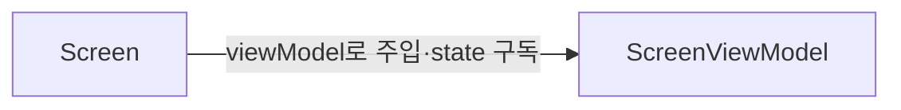

### Dependency

오버로드 선택 확인용 구조 뷰

### Responsibility

#### 요소의 책임

- <strong>Screen</strong>
  - <strong>책임 (추상)</strong>: 화면을 그리고 새로고침을 뷰모델에 넘긴다.
  - <strong>역할 (구체)</strong>: 공개 `Screen(vm)`이 상태를 구독하고 내부 `Screen(state, ...)`을 부른다.
- <strong>ScreenViewModel</strong>
  - <strong>책임 (추상)</strong>: 화면 상태를 만든다.
  - <strong>역할 (구체)</strong>: 설명에 명시되지 않음
