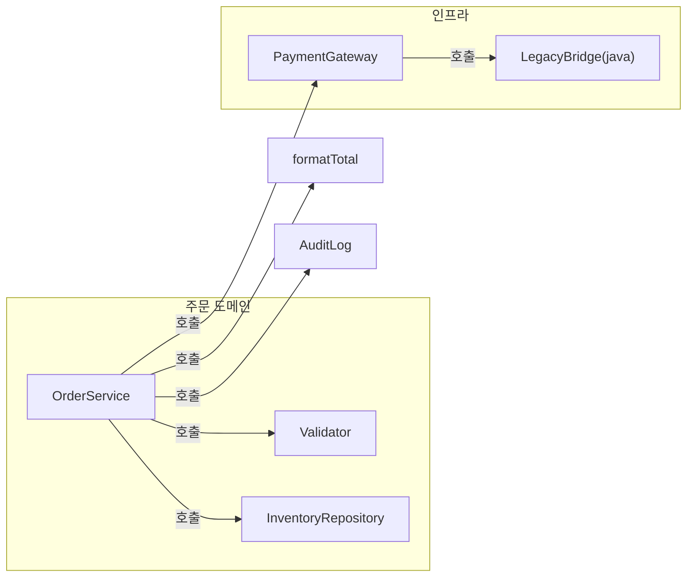

### Dependency

주문 처리 예제의 의존 구조

### Responsibility

#### 요소의 책임

- <strong>OrderService</strong>
  - <strong>책임 (추상)</strong>: 주문을 받아 처리한다.
  - <strong>역할 (구체)</strong>: `place()`에서 검증·재고 예약·결제·기록을 차례로 부른다.
- <strong>Validator</strong>
  - <strong>책임 (추상)</strong>: 주문이 올바른지 본다.
  - <strong>역할 (구체)</strong>: 설명에 명시되지 않음
- <strong>InventoryRepository</strong>
  - <strong>책임 (추상)</strong>: 재고를 예약한다.
  - <strong>역할 (구체)</strong>: `reserve()`
- <strong>formatTotal</strong>
  - <strong>책임 (추상)</strong>: 합계를 글로 바꾼다.
  - <strong>역할 (구체)</strong>: 설명에 명시되지 않음
- <strong>AuditLog</strong>
  - <strong>책임 (추상)</strong>: 주문 기록을 남긴다.
  - <strong>역할 (구체)</strong>: `record()`
- <strong>PaymentGateway</strong>
  - <strong>책임 (추상)</strong>: 결제를 요청한다.
  - <strong>역할 (구체)</strong>: `charge()`
- <strong>LegacyBridge</strong>
  - <strong>책임 (추상)</strong>: 설명에 명시되지 않음.
  - <strong>역할 (구체)</strong>: 설명에 명시되지 않음
